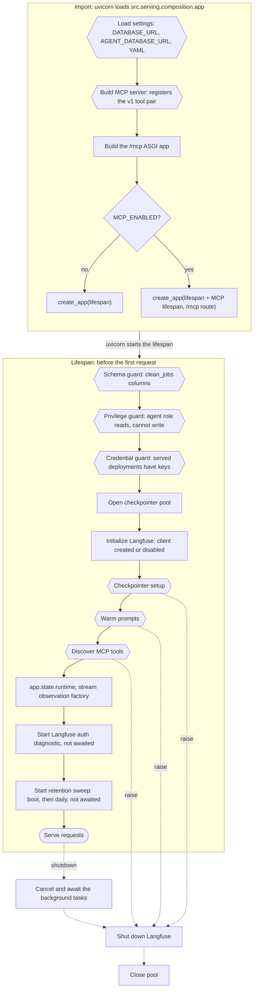

# Composition module guide

> **Last verified:** 2026-10-18

> **Eviction:** Rewritten whenever `src/serving/` changes; removed when the module is retired.

`src/serving/composition.py` is the one place that builds the running web service.
It builds the shared MCP tool server, wires the lifespan that checks the database and builds the
agent runtime, and exposes the ASGI `app` that Docker starts.
Nothing in the codebase imports it except the entrypoint and its tests.
This guide is the one owner of boot design.
Procedures (the agent read role, secrets, deploys) stay in
[the operate how-to](../how-to/operate.md).

## 1. Summary and scope

**Why boot lives here.**
Before #442, `src/api/app.py` built the runtime, the checkpointer, the schema guard, and the
Langfuse lifecycle itself, so the transport layer knew how the agent was built.
#442 (PR #443) moved that assembly out: `create_app` now takes a `lifespan` as a parameter.
`src/api/` imports no LangChain, Langfuse, checkpointer, or runtime module directly; its routes
call the application service (`src/agents/service.py`) with the runtime they find on `app.state`.
Composition is the only module allowed to know every layer at once, and the cost of that rule is
paid here and nowhere else.

**What it owns.**

- The process's single FastMCP job-query server, built once and shared by the agent and `/mcp`.
- The boot order: two database guards, the served-credential guard, the checkpointer pool, the
  Langfuse client, prompt warming, tool discovery, the runtime, and two fire-and-track tasks: the
  non-fatal Langfuse check and the daily checkpoint-retention sweep.
- The teardown order: both background tasks, then Langfuse, then the pool.
- Both ends of the Langfuse client's life: `init_langfuse` creates it after the guards, and the
  teardown chain drains it. Importing the tracing module has no side effect.
- The ASGI `app`, with or without the `/mcp` endpoint, chosen by `MCP_ENABLED`.

What it deliberately is not:

- **Not transport.** Middleware, CORS, rate limits, routes, and static files are `create_app`'s.
- **Not configuration.** It calls `load_settings` once, at import; parsing and validation live in
  `src/core/config.py`.
- **Not the agent.** It hands tools and a checkpointer to `AgentRuntime`; the model and graph are
  built later, on the first request for each prompt version.
- **Not the tracing layer.** What is observed, and how tags and prompt lineage are built, stay in
  `src/agents/tracing/`; composition only decides when the client starts and stops.

## 2. Boot in one picture

Boot happens in two phases.
**Import** runs when uvicorn loads `src.serving.composition:app`; **lifespan** runs before the first
request is accepted.
Hexagons can refuse to boot; dotted arrows are teardown, which runs whether boot succeeded or not
once the pool exists.

## 3. Stage by stage

| Stage | What it does | Code | On failure |
|---|---|---|---|
| Settings | Loads and validates `Settings` and every YAML file, before any other import | `src/core/config.py` → `load_settings` (called at composition import) | Import fails, uvicorn exits 1, in under two seconds |
| MCP server | Registers the v1 tool pair, `query_clean_jobs` and `get_job_details` | `src/agents/mcp/job_server.py` → `create_job_mcp_server` | Import fails, uvicorn exits 1 |
| App | Builds FastAPI with the lifespan, and `/mcp` before the static catch-all if enabled | `src/api/app.py` → `create_app` | Import fails |
| Schema guard | Live `clean_jobs` columns must equal `EXPECTED_COLUMNS` exactly | `src/api/schema_guard.py` → `assert_serving_schema` | `SchemaGuardError`; uvicorn exits 3 |
| Privilege guard | Agent role reads the 16 visible columns, cannot read a hidden column, and is refused a write | `src/api/privilege_guard.py` → `assert_agent_privileges` | `AgentPrivilegeError`; skipped with a warning if the DSNs name different databases |
| Credential guard | Each served profile's selected deployment has a nonempty API key | `src/agents/runtime/provider.py` → `assert_profile_credential` | `ProviderCredentialError`; uvicorn exits 3 |
| Pool | Creates and opens the checkpointer pool without waiting for a connection | `src/core/checkpointer.py` → `build_checkpointer_pool` | - |
| Langfuse init | Creates the client and callback handler when both keys are set and `LANGFUSE_ENABLED` is not false; never raises | `src/agents/tracing/langfuse.py` → `init_langfuse` | Logged; tracing disabled; boot continues |
| Checkpointer | Creates or migrates LangGraph's checkpoint tables on `DATABASE_URL` | `src/core/checkpointer.py` → `build_checkpointer` | Raises; pool closed |
| Prompts | Resolves every prompt from the checked-in YAML once and links the Langfuse version when its text agrees; each lookup is bounded by `agent.prompts.fetch_timeout_seconds` and never retried | `src/agents/tracing/langfuse.py` → `prepare_native_prompts_startup`; `src/agents/tracing/prompt_registry.py` → `PromptRegistry.refresh` | Langfuse errors leave the surface unlinked on the release text; a missing YAML prompt raises (#698) |
| Tools | Lists the MCP server's tools as LangChain tools, in process | `src/agents/mcp/adapter.py` → `list_job_tools` | Raises before the runtime exists |
| Runtime | `AgentRuntime(checkpointer, tools)` on `app.state.runtime` | `src/agents/runtime/react_agent.py` → `AgentRuntime` | - |
| Diagnostic | Resolves the Langfuse project id and logs credential diagnostics in a background task | `src/agents/tracing/langfuse.py` → `diagnose_langfuse_startup` | Logged only; the trace link stays null until the next process start |
| Prompts live | Refreshes the in-memory prompt links every `agent.prompts.refresh_interval_seconds`, first wait included, in a background task; a turn reads only memory | `src/agents/tracing/langfuse.py` → `refresh_prompt_links_forever`; `src/agents/tracing/prompt_registry.py` → `PromptRegistry.refresh_async` | Logged per surface; the loop retries at the next interval; a turn is never waiting on it (#698) |
| Retention | Deletes threads whose newest checkpoint is older than `agent.memory.retention_days`, once at boot and then daily, in a background task | `src/serving/composition.py` → `_sweep_checkpoint_threads`; `src/core/checkpointer.py` → `delete_stale_threads` | Logged; the loop retries at the next interval (#673) |

**Why the guards run first.**
uvicorn accepts no request until the lifespan finishes, so a guard that raises means the process
never answers, and a deploy never passes Render's `/api/v1/health` check.
That is the point: the schema guard turns a renamed column into a refused boot instead of a 500 on
the first question, the privilege guard does the same for a lost or broadened `GRANT` after a table
rebuild (#509, #722), and the credential guard does the same for a missing provider key that would otherwise fail
every question (#641).
The database guards run in a worker thread (`asyncio.to_thread`) because they use synchronous
SQLAlchemy; the credential guard only reads settings, so it runs inline.
Each connection attempt is bounded by the service-owned `database.connect_timeout_seconds` (10 s),
so an unreachable database refuses boot with `SchemaGuardError` within the bound whatever the DSN
carries (#642).

**Configuration loads first, at import.**
`load_settings()` is the first statement composition's module body runs, before the LangChain,
LiteLLM, and FastMCP imports, so a bad configuration refuses boot in about two seconds instead of
after a fifteen-second import chain, and the traceback names `composition.py` rather than a symptom
further down.
The process parses configuration once, here: the lifespan, the runtime, and every tool read the
cached settings later, so a bad file refuses boot at import instead of at the first request.
The Langfuse client reads its keys later, when the lifespan initializes tracing.
The lifespan therefore reloads nothing, and the test that pins this imports the entrypoint in a
fresh interpreter with no database configured (`test_import_fails_fast_when_config_load_fails`)
instead of patching a call that cannot fail (#640).

**One MCP server, built at import.**
The agent and the optional `/mcp` endpoint must expose the same tools, so there is exactly one
server, `_mcp_server`.
It is built at import, not in the lifespan, because `create_app` needs the `/mcp` routes when the
app object is constructed, which is before any lifespan runs.
There is no switch left to follow: `create_job_mcp_server` registers the v1 tool pair
unconditionally, and there is exactly one system prompt, so the prompt and the tools cannot
disagree (ADR-0060).

**Tool discovery happens once, and all or nothing.**
`list_job_tools` connects to the in-process server object directly: no socket, no URL.
If it raises, `app.state.runtime` is never set, so the service cannot publish an agent with a
partial tool surface.

**The MCP endpoint is off by default.**
`MCP_ENABLED` must be `1`, `true`, or `yes`; Render never sets it (#465, option A: internal and
development use only).
When on, the MCP session manager's lifespan is combined with the service lifespan: it starts after
the service is ready and stops before the service tears down.

**Teardown is nested `finally` blocks.**
Each step runs even if the one before it raised: the diagnostic is cancelled and awaited, Langfuse
flushes in a thread, and the pool closes last.
A failure in the guards happens before the pool exists, so there is nothing to tear down.

## 4. Contract

**Upstream: what composition hands to the API layer.**

| Name | Kind | Consumer |
|---|---|---|
| `app` | ASGI app, `src.serving.composition:app` | `docker/Dockerfile` `CMD`, README, `tests/api/test_query.py` |
| `lifespan` | async context manager | `tests/api/test_startup_config.py` builds its own app around it |
| `app.state.runtime` | `AgentRuntime` | `src/api/routes/query.py` → `query_agent`, `stream_query_agent` |
| `app.state.stream_observation_factory` | callable returning a stream observation | `query_agent`, `stream_query_agent`; falls back to a no-op if absent |
| `MCP_ENABLED` | environment variable | read once at import |

`app.state` is a temporary seam from #442: routes reach the runtime through it, instead of
through an application-service dependency.
Replacing it is a later boundary change ([component index](../refactor/component-index.md)).

**Downstream: what composition imports.**
`src.agents.mcp`, `src.agents.runtime`, `src.agents.tracing`, `src.api`, and `src.core`.
The arrow only points down: none of those import `src.serving`.
The API layer gets the lifespan and the MCP app as arguments to `create_app`, and the runtime
through `app.state`.
`evals/run.py` deliberately builds its own MCP server rather than importing composition, which
would pull in the API layer, the pool, and the production database.

**Process model.**
One process (`WEB_CONCURRENCY=1` in `render.yaml`, which uvicorn reads as its worker count), so
one pool, one runtime, and one MCP server per deploy.

## 5. Reading a boot

A healthy boot logs, in order: `api.schema_ok`, `api.agent_privileges_ok`,
`api.provider_credentials_ok` (with the profiles checked), and `langfuse.prompts_prefetched` (with
each prompt's release version, a `linked` flag per surface, and the served system surface).
During the boot resolution, a labelled version that resolves logs `prompt.linked` or `prompt.drift` for that surface; a version that cannot be read leaves the surface unlinked, which `linked` makes visible instead of printing a release version that reads as success (#698).
The Langfuse authentication result lands near uvicorn's `Application startup complete`, before
or after it, because the diagnostic is not awaited.

| You see | Phase | Meaning |
|---|---|---|
| Traceback through `composition.py` at `load_settings()`, exit 1, under two seconds | Import | Settings failed: a missing `DATABASE_URL` or `AGENT_DATABASE_URL`, bad YAML, an invalid `agent` section. Nothing else is imported yet |
| `Langfuse tracing disabled...` | Lifespan | `LANGFUSE_ENABLED` is false, the keys are missing, or client creation failed; serving is unaffected |
| `api.schema_drift`, `SchemaGuardError`, `Application startup failed`, exit 3 | Lifespan | `clean_jobs` differs from `EXPECTED_COLUMNS`; a migration and the guard disagree |
| `AgentPrivilegeError` naming the operate how-to | Lifespan | The agent role lost `SELECT` or can write; re-apply the role steps |
| `api.agent_privilege_check_skipped` | Lifespan | The two DSNs name different databases; nothing was checked |
| `ProviderCredentialError` naming the variable and the operate how-to | Lifespan | A deployment a served profile selects has no key; set it in the Render dashboard and redeploy |
| `SchemaGuardError` naming `connection timeout expired`, `Application startup failed`, exit 3 | Lifespan | The database is unreachable; the connect attempt is bounded by `database.connect_timeout_seconds`, see section 6 |
| `Langfuse startup authentication failed` | After boot | Tracing keys are wrong; serving is unaffected, and turns serve a null `trace_url` |
| `langfuse.prompt_resolution_failed` per surface | Boot, then every `agent.prompts.refresh_interval_seconds` | A labelled version could not be read within `agent.prompts.fetch_timeout_seconds`; the release text serves unlinked and the next refresh retries (#698) |
| `checkpointer.retention_swept`, with `deleted_threads` and `retention_days` | After boot, then daily | The sweep ran; compare `SELECT count(DISTINCT thread_id) FROM checkpoints` before and after a short-retention run |
| `checkpointer.retention_sweep_failed`, with a traceback | After boot, or later | A sweep failed; serving is unaffected and the loop retries at the next interval (#673) |

## 6. Trade-offs, and what would now be decided differently

**Deliberate, and still right.**

- **Fail loud at boot, never degrade.** A service that boots with a broken table or role fails on
  real users instead of on the deploy.
- **Configuration loads at import, before anything else.** The lifespan cannot reload settings, so
  it does not pretend to. The refusal is uvicorn's, at import, with the missing variable named.
- **Database connection attempts are bounded by the service, not the DSN.** Both engines and the
  checkpointer pool carry `database.connect_timeout_seconds` (10 s), so an unreachable database
  refuses boot with `SchemaGuardError` within the bound whatever the DSN string carries (#642).
- **Served deployments carry their keys at boot.** The credential guard checks the deployments the
  served tool surface can invoke, `react` and `sql_generation`, so a checkout needs only each served
  deployment's key (#641).
- **Tracing never blocks boot.** Langfuse is optional: prompts serve the reviewed YAML text and
  link a managed version only when its text agrees, the client is created locally with no network
  round trip, and the credential check is fire-and-track so boot never waits on a response.
- **Retention never gates boot or a request.** The sweep is a fire-and-track task like the Langfuse
  diagnostic; a failed sweep is logged and retried at the next interval, so housekeeping cannot
  turn a healthy service into a failed deploy (#673).
- **The API layer takes a lifespan instead of building one.** That keeps direct LangChain,
  Langfuse, and checkpointer imports out of `src/api/`, as `AGENTS.md` requires.

**Would now be decided differently.** Each was observed by running the code on 2026-10-16, and
each is tracked by its own follow-up issue.
All four observations have since been resolved: configuration failing at import while the lifespan
pretended to load it (#640, now the second deliberate choice above), a missing provider key booting
green and failing every question (#641, now a deliberate choice above), an unreachable database
hanging boot (#642, now a deliberate choice above), and composition shutting down a Langfuse client
it did not create (#643: the client is now created by `init_langfuse` in the lifespan, and
importing the tracing module has no side effect).

## 7. Changing it safely

**Add a boot dependency.**
Create it in `lifespan` after the guards, release it in the `finally` chain in reverse order, and
add its step to the expected order in `test_lifespan_preserves_dependency_lifecycle_order`.
If routes need it, pass it through `app.state` for now, and note it on the seam in section 4.

**Add a boot guard.**
Put it before `build_checkpointer_pool`, so a refusal leaves nothing to tear down.
Run synchronous database work through `asyncio.to_thread`, raise a named error, and say in the
message which procedure fixes it, as `AgentPrivilegeError` and `ProviderCredentialError` do.

**Change the tool surface.**
Edit `create_job_mcp_server`, not composition; the agent and `/mcp` follow automatically.
A tool rename is a compatibility decision (#465), and prompts and evals name the tools.

**Change the entrypoint path.**
`docker/Dockerfile` `CMD`, the README run command, `docs/reference/configuration.md`, and the tests
that import `src.serving.composition` all name it; move them in one pull request, as #443 did.

## 8. Code map

| Start here | For |
|---|---|
| `src/serving/composition.py` → `lifespan` | Boot and teardown order |
| `src/serving/composition.py` → module body | The import-time configuration contract |
| `src/serving/composition.py` → `app`, `_mcp_server`, `_mcp_asgi` | Import-time assembly and the MCP switch |
| `src/api/app.py` → `create_app`, `_register_mcp_before_static` | How the lifespan and `/mcp` are attached |
| `src/api/schema_guard.py` → `assert_serving_schema`, `EXPECTED_COLUMNS` | Schema guard |
| `src/api/privilege_guard.py` → `assert_agent_privileges` | Privilege guard |
| `src/agents/runtime/provider.py` → `assert_profile_credential`, `build_model` | Credential guard and model construction |
| `src/core/checkpointer.py` → `build_checkpointer_pool`, `build_checkpointer`, `delete_stale_threads` | Pool, checkpoint tables, and the retention sweep's deletion |
| `src/core/db.py` → `connect_timeout_seconds` | The service-owned connect bound carried by both engines and the checkpointer pool |
| `src/core/config.py` → `load_settings`, `ConfigLoadError` | The import-time configuration contract |
| `src/agents/mcp/job_server.py` → `create_job_mcp_server`, `mcp_endpoint_enabled` | Tool surface, endpoint switch |
| `src/agents/mcp/adapter.py` → `list_job_tools` | Tool discovery |
| `src/agents/tracing/langfuse.py` → `init_langfuse`, `prepare_native_prompts_startup`, `refresh_prompt_links_forever`, `diagnose_langfuse_startup`, `shutdown_langfuse` | Tracing lifecycle |
| `tests/api/test_startup_config.py`, `tests/api/test_mcp.py`, `tests/api/test_privilege_guard.py`, `tests/api/test_retention.py` | The behaviour pinned by tests |
