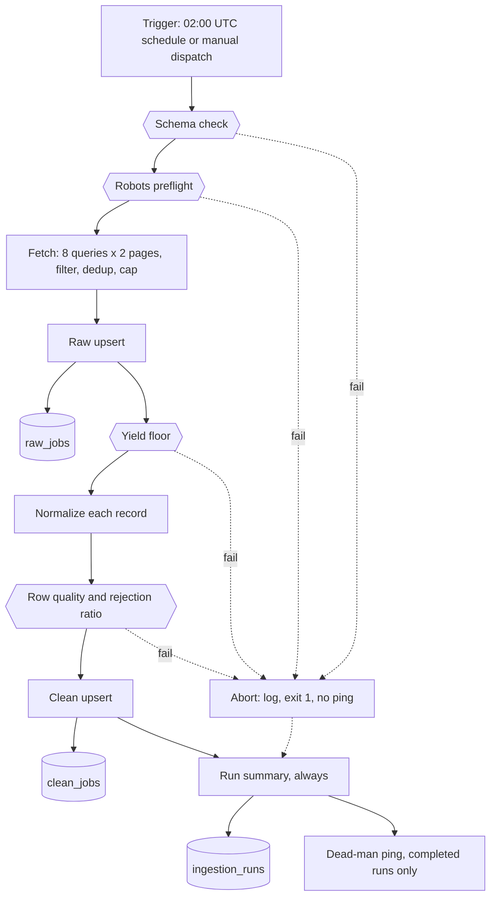

# Ingestion module guide

> **Last verified:** 2026-10-12

> **Eviction:** Rewritten whenever the ingestion module changes; removed when the module is retired.

Every night at 02:00 UTC, ingestion fetches VietnamWorks IT AI/Data postings, lands them verbatim in
`raw_jobs`, cleans them into `clean_jobs`, and appends one `ingestion_runs` row for the attempt.
This guide is the one owner of ingestion design.
Procedures (migrations, robots incidents, recovery) stay in [the operate how-to](../how-to/operate.md).

## 1. Summary and scope

One source (the VietnamWorks public JSON search API), scheduled by `.github/workflows/ingestion.yml`
(cron `0 2 * * *` plus manual `workflow_dispatch`).
Code is `src/services/ingestion/`, entered at `python -m src.services.ingestion.loader`
(`src/services/ingestion/loader.py` → `run_ingestion`, `main`), which owns the order, the summary,
and the exit code.

What it deliberately is not:

- **No history.** `raw_jobs` keeps the latest payload per posting.
- **No second source, no source abstraction.** The loader calls the VietnamWorks adapter directly.
- **No lifecycle flag.** Nothing is deleted or marked inactive; the agent counts every posting ever
  collected.
- **No publish date.** `posted_date` stays NULL because the source has no reliable one.
- **No LLM.** Every transform is a pure function of the payload and the YAML config.

Decisions:
- [ADR-0058](../decisions/adr-0058-single-source-mvp-ingestion.md): single source, drop and count
- [ADR-0057](../decisions/adr-0057-nightly-ingestion-restored.md): nightly schedule restored
- [ADR-0059](../decisions/adr-0059-no-stored-posting-lifecycle.md): no stored lifecycle
- [ADR-0034](../decisions/adr-0034-vietnamworks-robots-and-terms-gate.md): robots and terms gate
- [ADR-0010](../decisions/adr-0010-created-on-preserved-posted-date-never-synthesized.md): no posted date

## 2. The run in one picture

Hexagons are gates that can abort the run; cylinders are the three tables the module writes.



## 3. Stage by stage

| Stage | What it does | Code | Writes | On failure (`outcome` / `failure_phase`) |
|---|---|---|---|---|
| Schema check | Compares live `clean_jobs` columns with the ORM | `src/services/ingestion/safety.py` → `assert_clean_jobs_schema` | none | `safety_aborted` / `schema_check` |
| Robots preflight | Fetches and evaluates robots.txt for the API host | `src/services/ingestion/compliance.py` → `RobotsPolicyGate` | none | `safety_aborted` / `fetch` |
| Fetch | Builds the source from config, then queries, filters, dedups, caps, retries | `src/services/ingestion/sources/vietnamworks.py` → `VietnamWorksSource` | none | `failed` / `source_initialization` or `fetch` |
| Raw upsert | Lands payloads, counts new, changed, unchanged | `src/services/ingestion/raw_store.py` → `upsert_raw_postings` | `raw_jobs` | `failed` / `raw_upsert` |
| Yield floor | Aborts if fewer than `safety.min_yield` postings | `src/services/ingestion/safety.py` → `assert_min_yield` | none | `safety_aborted` / `yield_check` |
| Normalize, row quality | Maps each payload to a `NormalizedJob`, drops rows that break a rule, aborts above the ratio | `src/services/ingestion/normalize/vietnamworks.py` → `to_normalized_job`; `src/services/ingestion/safety.py` → `partition_by_row_quality`, `assert_rejection_ratio` | none | bad record dropped and counted; above the ratio `safety_aborted` / `row_quality_check` |
| Clean upsert | Upserts accepted rows, refreshes `last_seen_at` | `src/services/ingestion/clean_store.py` → `upsert_clean_jobs` | `clean_jobs` | `failed` / `clean_upsert` |
| Run summary, ping | Appends the attempt (best effort); pings the dead-man monitor if completed | `src/services/ingestion/run_store.py` → `persist_ingestion_run`; `src/services/ingestion/safety.py` → `send_dead_man_ping` | `ingestion_runs` | logged, outcome unchanged |

**What an abort leaves behind:**

| Aborts at | `raw_jobs` | `clean_jobs` | `ingestion_runs` |
|---|---|---|---|
| Schema check, robots, fetch | untouched | untouched | one row |
| Raw upsert | untouched, the one statement rolls back | untouched | one row |
| Yield floor, row quality | **written** | untouched | one row (`skipped` set by row quality) |
| Clean upsert | written | untouched, the one statement rolls back | one row |

**Robots preflight.**
The gate runs inside the lazy `fetch` generator, so its aborts report `failure_phase = fetch`.
It fails closed because an unattended run cannot ask permission (ADR-0034).
Only one failure is permitted: an HTTP 404 from `ms.vietnamworks.com`, meaning no policy exists.
That logs `ingestion.robots_policy_absent_permitted` and proceeds; every other outcome aborts first.

| robots.txt returns | Result |
|---|---|
| 404, or 200 with no matching rule | Permitted (a 404 is logged and never cached) |
| 403, 429, any 5xx, other non-2xx, timeout, network error | Blocked, `robots_unavailable` |
| 200 but unparseable | Blocked, `robots_malformed` |
| 200 with a matching `Disallow` for `/job-search/v1.0/search` | Blocked, `robots_disallowed` |

Matching follows RFC 9309 (longest rule wins, `Allow` wins a tie).
A block logs `ingestion.compliance_gate_blocked`, then `ingestion.aborted`, and exits 1.

**What is searched.**
Each request sends one of these eight keywords (`queries`) as its `query` field:

1. `data scientist`
2. `data engineer`
3. `data analyst`
4. `machine learning`
5. `AI engineer`
6. `MLOps`
7. `computer vision`
8. `deep learning`

**Fetch selection and bounds.**

- **Recall:** the queries above, deduplicated by `jobId` across queries and pages.
  Keyword search alone is noisy (it matches description text, surfacing Sales and Marketing roles).
- **Precision:** keep a hit only if `jobFunction.parentId` equals `job_function.parent_id` and one
  child id is in `job_function.child_ids`.
- **Order:** page-major (page 0 of every query, then page 1), so a cut-short run thins all evenly.
- **Page size:** 50 hits per request (`api.hits_per_page`), 2 pages per query: at most 800 hits
  before filtering. 50 is the spike's value (`scripts/scrape_spike.py`); no measurement is recorded.

| Bound | Value | Source |
|---|---|---|
| Requests | 8 queries x 2 pages = 16, plus one robots GET, plus retries | `queries`, `api.pages_per_query` |
| Records | at most 150 kept | `max_jobs` |
| Time | no new request after 600 s; the page in flight still finishes | `api.max_elapsed_seconds` |

**Retry ladder.**

- A page gets up to 3 tries, waiting 2 s then 4 s between them.
- Only transient failures retry: HTTP 429, any 5xx, timeouts, transport errors.
  Other 4xx give up at once, because a retry cannot fix them and would mask a block.
- A page that gives up logs `ingestion.page_failed` and adds 1 to `pages_failed`; the run goes on.
  A source that fails everywhere ends at the yield floor.
- The wall-clock budget exists because on 2026-08-18 every request hung for its full timeout: about
  26 minutes of work under a 15-minute job timeout, so the runner killed the job unlogged.

**Raw upsert.**

- It runs before the yield and row-quality gates, so a bad run keeps its payloads for diagnosis,
  and after the schema and robots gates, which prove the run may touch the database and source.
- One statement upserts every row on `(source, external_id)`.
  A Postgres advisory lock serializes the new/changed/unchanged count with the write, so counts stay
  exact if two runs overlap.
  Changes are detected by comparing `content_hash`, a SHA-256 of the canonical JSON payload.

**Drop and count (ADR-0058).**

- A record that raises in `to_normalized_job`, or breaks a row-quality rule, is dropped and counted
  in `skipped`.
  The rules: non-blank `title` and `company`, finite salary bounds, `salary_min <= salary_max`, and
  `listing_expires_on` not before `posted_date` (which cannot fire today: `posted_date` is NULL).
- A dropped row keeps its old `clean_jobs` version; its `last_seen_at` is not refreshed that day.
- The run aborts only if `skipped / fetched` is strictly above `safety.max_rejected_ratio` (0.10).
  One bad record should cost one row, not the night, while a broken mapping still stops the run.
- One malformed record: `skipped = 1`, `ingestion.rows_rejected`, run completes.
  15% malformed: `ingestion.rejection_ratio_exceeded`, `safety_aborted` / `row_quality_check`.

**Clean upsert.**
One statement upserts all accepted rows on `(source, external_id)`.
Postgres cannot touch one key twice in a statement, so duplicates collapse first, last write wins.
It sets every enriched column and `last_seen_at = now()`, and never `id` or `first_seen_at`.

**Run summary and ping.**

- The summary is written in a `finally`, so aborted and failed attempts leave a row.
  Counters for stages never reached are NULL, never a fake zero.
  The row holds no payload, title, company, URL, or exception text.
- The ping follows `ingestion.completed` only, so the monitor alerts on silence, even for a crash.

## 4. Data

| Table | Purpose | Natural key | Overwritten | Never touched |
|---|---|---|---|---|
| `raw_jobs` | Latest verbatim payload per posting | `(source, external_id)` | payload, hash, URL, `fetched_at` | `id` |
| `clean_jobs` | Enriched table the agent reads | `(source, external_id)` | enriched columns, `last_seen_at` | `id`, `first_seen_at` |
| `ingestion_runs` | One row per attempt | `id` only | nothing, append-only | everything |

**Mapping to `clean_jobs` (21 columns).**
Source field names live in `to_normalized_job`; shared rules live in
`src/services/ingestion/transform.py`.

| Column | Source field(s) | Rule | Code |
|---|---|---|---|
| `id` | none | database identity | `CleanJob` |
| `source` | none | constant `vietnamworks` | `to_normalized_job` |
| `external_id` | `jobId` | `str(jobId)`; a missing id raises, so the record is dropped | `to_normalized_job` |
| `source_url` | `jobUrl` | copied | `to_normalized_job` |
| `title`, `company` | `jobTitle`, `companyName` | copied raw; blank fails row quality | `to_normalized_job` |
| `role` | `jobTitle` | first taxonomy keyword in the lowercased title, YAML order; else `"Other"` | `classify_role` |
| `description` | `jobDescription`, `jobRequirement`, `benefits` | HTML stripped, joined by a blank line; NULL if empty | `html_to_text` |
| `tech_stack` | `skills[].skillName` + description | whole-token match on `config/tech_vocabulary.yaml`, longest alias first, canonical names, comma-joined; NULL if none | `find_tech_stack` |
| `job_level` | `jobLevel`, else `jobLevelVI` | copied | `to_normalized_job` |
| `location` | `address`, `workingLocations[].cityName` | whole-word alias match, ordered by first appearance; else `"Other"` | `normalize_location` |
| `posted_date` | none | always NULL, see below | `to_normalized_job` |
| `listing_expires_on`, `created_on` | `expiredOn`, `createdOn` | ISO date, NULL if unparseable | `to_date` |
| `is_internship` | `jobLevel`, `jobLevelVI` | contains `intern` or `thực tập`; the title is not checked | `derive_is_internship` |
| `salary_min`, `salary_currency` | `salaryMin`, `salaryCurrency` | only when `isSalaryVisible`, else NULL | `to_normalized_job` |
| `salary_max` | `salaryMax` | only when visible; `0` with a positive min means no upper bound, becomes NULL | `_collapse_zero_max_sentinel` |
| `is_salary_negotiable` | `isSalaryVisible` | `not isSalaryVisible`; a missing key counts as negotiable | `to_normalized_job` |
| `first_seen_at` | none | database default `now()`, insert only | `CleanJob` |
| `last_seen_at` | none | `now()` on insert and on every upsert | `upsert_clean_jobs` |

HTML stripping replaces tags with spaces, unescapes entities, and collapses whitespace.
Without the zero-max rule a lower-bound-only salary fails row quality as inverted bounds (#464).
The role and city maps in `config/ingestion.yaml` also feed the agent's query vocabulary.

**`is_salary_negotiable = true`** means VietnamWorks hid the salary, nothing more.
Evidence: in `tests/services/ingestion/fixtures/vietnamworks_raw.json`, both hidden-salary postings
carry `isSalaryVisible: false`, null salary fields, and `prettySalary: "Thương lượng"`
("Negotiable"), the text VietnamWorks displays.
Two records show the pairing; they do not measure how often it holds live.

**Why `posted_date` is always empty.**

- The source timestamps each mean something else: `onlineOn` changes on every employer re-list,
  `approvedOn` is an admin approval time, and `expiredOn` is a future date (ADR-0010).
- The closest honest substitute is `created_on`, the stable record-creation date, which the agent
  labels as record creation, never publication.
  `first_seen_at` (when this project first saw the posting) is deliberately not substituted.

**Hidden from the agent: 5 columns.**

- `source`, `external_id`, `posted_date` are bookkeeping or always NULL; `first_seen_at` and
  `last_seen_at` are lifecycle data that ADR-0021 hides until honest presentation is measured.
- The boundary is `VISIBLE_COLUMNS` in `src/services/query/compiler.py` and the projection in
  `src/services/query/job_details.py` → `fetch_job_details`, not a database grant.

**Deletion.**

- No posting is ever deleted or marked inactive; one that leaves search keeps its last version and
  its `last_seen_at` stops advancing.
- The agent counts every posting ever collected and never claims one is open (ADR-0059);
  `listing_expires_on` is the only open/closed signal (ADR-0011).

## 5. Reading a run

Healthy means `outcome = completed`, `failure_phase` NULL, `fetched` about 105 to 113, `skipped` 0,
`pages_failed` 0, and `clean_loaded = fetched`.

- Real green runs: `36299600573` (2026-09-27, dispatch) fetched 105; `37318661030` (2026-10-05,
  dispatch) fetched 110; `37436366175` (2026-10-06, first scheduled) fetched 113.
- `raw_changed` was high in all three (16, 85, 110); which payload fields move is undiagnosed.

A healthy run logs, in order: `ingestion.schema_ok`, `ingestion.robots_policy_absent_permitted`,
`ingestion.summary_persisted`, `ingestion.completed`, `ingestion.ping_sent`.
`/api/v1/ready` reports `MAX(last_seen_at)` as the data date.

```sql
SELECT id, started_at, finished_at - started_at AS took, outcome, failure_phase,
       fetched, raw_new, raw_changed, raw_unchanged, clean_loaded, skipped, pages_failed
FROM ingestion_runs
ORDER BY started_at DESC
LIMIT 14;
```

A night with no row means the process died before the summary: a runner kill at the 15-minute
timeout, or a failure before `run_ingestion` starts, such as config load.

| Event | Level | Meaning |
|---|---|---|
| `ingestion.schema_drift` | error | Live columns differ from the ORM; abort at `schema_check`. Needs a migration |
| `ingestion.compliance_gate_blocked` | warning | Robots denied; `reason` says why. Do not retry around it |
| `ingestion.page_failed` | warning | A page gave up after retries; run continues. Occasional is normal |
| `ingestion.budget_exhausted` | warning | The 600 s fetch budget ran out; logged once. Source is slow |
| `ingestion.yield_floor_breached` | error | `fetched` below `safety.min_yield`; source or filter broke |
| `ingestion.normalize_skipped` | warning | One record failed to normalize; logs its `external_id` |
| `ingestion.rows_rejected` | warning | Dropped rows counted by rule; no identifiers |
| `ingestion.rejection_ratio_exceeded` | error | Too many drops; abort at `row_quality_check` |
| `ingestion.aborted` | error | CLI line for any safety abort; exit code 1 |
| `ingestion.summary_persist_failed` | warning | The run finished but its `ingestion_runs` row was not written |
| `ingestion.ping_skipped`, `ingestion.ping_failed` | info, warning | No monitor URL set, or the ping request failed |

A non-safety exception (database error, a response body that is not JSON) propagates as a traceback,
exits non-zero, and records `outcome = failed`.
Neither failure kind pings the monitor, and `pages_failed` never changes the exit status.

## 6. Configuration knobs

All keys are in `config/ingestion.yaml`.

| Key | Value | Effect | Coupled to |
|---|---|---|---|
| `api.url`, `api.hits_per_page`, `api.pages_per_query` | search endpoint, 50, 2 | Where requests go; hits per request; pages per query | `robots.target_path` must name the endpoint's path; request count |
| `api.timeout_seconds`, `api.retry_attempts`, `api.retry_backoff_seconds` | 30, 2, 2.0 | Request timeout (robots GET too), retries, base backoff (doubles) | worst page 3 x 30 + 2 + 4 = 96 s |
| `api.delay_seconds`, `api.user_agent` | 0.6, `InternHunterAgent/1.0 (+repo URL)` | Pause after every page (about 10 s per run); honest client name | robots rules are tested for this token |
| `api.max_elapsed_seconds` | 600 | Fetch wall-clock budget | **600 + 96 s must stay under workflow `timeout-minutes: 15`** |
| `robots.url`, `robots.target_path` | `ms.vietnamworks.com` robots.txt, `/job-search/v1.0/search` | Policy and path tested | exact API host, not `www`; `api.url` |
| `robots.cache_ttl_seconds`, `robots.allow_404` | 300, true | Policy cache (idle in a one-shot run); permits the reviewed 404 | ADR-0034; `allow_404: false` blocks every run today |
| `queries`, `job_function.parent_id`, `child_ids` | 8 AI/Data terms; 5, `[27]` | Keyword recall; precision filter | each query adds 2 requests; VietnamWorks' own taxonomy ids |
| `max_jobs` | 150 | Safety ceiling, not a target | real yield is 105 to 113; raise before it binds |
| `safety.min_yield`, `safety.max_rejected_ratio` | 20, 0.10 | Yield floor; abort threshold, strictly above | lowering either weakens a guard; ADR-0058 |
| `role_taxonomy`, `city_alias_map` | 6 roles; 20 aliases | Title keywords, **order matters**; location aliases, order breaks ties | agent query vocabulary and prompts |
| `tech_dictionary` | seed list | Input to `scripts/build_tech_vocabulary.py` only | runtime reads `config/tech_vocabulary.yaml` |

Safe alone: `queries`, `max_jobs` (watch the yield), `api.delay_seconds`.
Coupled: the timing keys to the workflow timeout; the role and city maps to serving prompts.

## 7. Changing it safely

**Change a field mapping.**

- Edit `to_normalized_job`, the shared function in `transform.py`, or the YAML map, and update
  `tests/services/ingestion/test_normalize_vietnamworks.py` or `test_transform.py`.
- Existing rows change only when the posting is next returned by search and passes the gates;
  no rebuild-from-`raw_jobs` script exists.
  If a canonical role or city name changes, check `config/prompts.yaml` and the serving vocabulary.

**Add a `clean_jobs` column.**

- Change in one pull request: an Alembic revision after `uv run alembic heads`, `CleanJob` and
  `NormalizedJob` in `models.py`, the normalizer, both dicts in `upsert_clean_jobs`, and
  `EXPECTED_COLUMNS` in `src/api/schema_guard.py`.
- If the agent should see it, also update the prompt surfaces in `config/prompts.yaml`,
  `VISIBLE_COLUMNS`, `fetch_job_details`, [the schema reference](../reference/schema.md), and
  `evals/fixtures/seed_eval_db.sql`.
  If hidden, add it to `NON_AGENT_VISIBLE_COLUMNS` in `tests/test_prompt_consistency.py`.
- Both guards demand an exact column match, Render deploys `main` on merge, and production is
  migrated by hand, so no single order keeps both green.
  Use a temporary tolerance in two steps, as #624 did.

**Add a search query or change the filter.**
Edit `queries` or `job_function`, run a manual dispatch, and check `fetched` stays between
`safety.min_yield` and `max_jobs`; each query adds two requests.

**Add a second source.**
Write a new ADR first (ADR-0058 requires it), then a small source interface, a second normalizer,
and a robots gate for that host.
The tables already key on `(source, external_id)`; the loader calls VietnamWorks directly.

## 8. Known limits and history

**Limits.**

- Role, location, and tech-stack accuracy is unmeasured; the defects below are tracked in #632.
- The role classifier reads the title only, as a substring match.
  `jobFunction` filters the fetch but is not used for the role, although the YAML comment and the
  `classify_role` docstring describe a tiebreaker.
  "Senior HTML Engineer" contains `ml engineer`, so it becomes ML Engineer.
- Short technology names match plain prose: "go to market" and "R&D" yield `Go`, `R`, and `D`.
- Unknown cities become `"Other"`, `is_internship` ignores the title, and the corpus only grows
  with no listing history.

**What was removed, and why.**

| Removed | Why | Issue |
|---|---|---|
| Evidence layer: shadow writer, collection plans, nine evidence tables | Never ran in production, written only by tests; about 2,160 of 3,900 module lines; tables dropped behind an emptiness guard | #620 (#626), #621 (#627) |
| Bright Data / LinkedIn adapter, source registry, base class | No second source is in scope; an abstraction over one source | #620 |
| Abort on any bad row | One record cost the whole night; now drop and count | #622 (#628) |
| `clean_jobs.is_active`, `ingestion_runs.expired_count`, expiry pass | A function of `last_seen_at`; no reader. Until the #624 follow-up, `src/services/ingestion/safety.py` and `src/api/schema_guard.py` still tolerate a leftover `is_active` column; older logs show `columns: 22` and `expired_count` | #624 (#631), ADR-0059 |

The removed code is on git tag `ingestion-evidence-archive` (ADR-0058).
