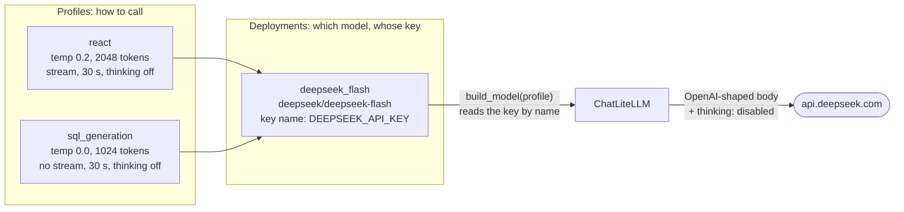

# Model config module guide

> **Last verified:** 2026-10-17

> **Eviction:** Rewritten whenever `agent.providers`, `agent.react`, `agent.sql_generation`, or `src/agents/runtime/provider.py` changes; removed when the module is retired.

The model config answers one question for the rest of the codebase: "give me a chat model for this job".
A caller names a job, called a **profile**, and gets back a configured `ChatLiteLLM` client.
It never names a model, an endpoint, or a key.
This guide owns which models serve, why there are two profiles with different settings, and what the timeouts, retries, and turn deadline protect against.
Procedures for setting keys and pricing in Langfuse stay in [the operate how-to](../how-to/operate.md), and the key reference is in [the configuration reference](../reference/configuration.md).

## 1. Summary and scope

**Four words first.**

- **Deployment.** A named, reviewed entry in `agent.providers`: one LiteLLM model string and the *name* of the environment variable that holds its key.
- **Profile.** A job the app needs a model for.
  There are exactly two, fixed in code by `AGENT_PROFILES`: `react`, the conversational agent, and `sql_generation`, the model call inside the `query_clean_jobs` tool that writes SQL.
- **Provider options.** The few vendor-specific knobs a profile may set.
  Today that is DeepSeek's `thinking`.
- **LiteLLM.** A library that speaks one request shape to many vendors.
  We use it in process through `ChatLiteLLM`, with no proxy server (ADR-0054).

**What it owns.**

- The deployment allowlist and the two profiles in `config/settings.yaml`.
- Validating that section when settings load, so a malformed one refuses boot.
- Resolving a profile to its deployment, reading the key by name, and building the client.
- The boot check that every served profile's key is set.
- The provider and model names that tracing attaches to every trace.

What it deliberately is not:

- **Not prompts.** The text sent to the model is the prompts module's (`config/prompts.yaml`, the Langfuse label).
- **Not the agent loop.** It builds a model; the runtime decides when to call it, and the service enforces the turn deadline (section 5).
- **Not a gateway.** No routing, no fallback, no per-request choice.
  The deployment is fixed by reviewed config.

**Which models serve.**
Both profiles select one deployment, `deepseek_flash`, which is `deepseek/deepseek-flash` with `DEEPSEEK_API_KEY` (ADR-0045; #653 renamed it from the legacy `deepseek/deepseek-v4-flash` alias and refreshed the Langfuse prices).
Every allowlisted deployment is selected by a profile: the unused `groq_qwen` arm was removed by #655, because an arm nobody selects or exercises does not keep the provider seam honest, and that seam is now LiteLLM's (ADR-0054).

## 2. The shape

Read left to right.
A profile says *how* to call a model, a deployment says *which* model and *whose key*, and the runtime combines them into one client.



The whole contract is this excerpt of `config/settings.yaml`:

```yaml
agent:
  providers:
    deepseek_flash:
      model: deepseek/deepseek-flash
      api_key_env: DEEPSEEK_API_KEY
  stream_turn_timeout_seconds: 120
  react:
    deployment: deepseek_flash
    temperature: 0.2
    max_tokens: 2048
    timeout: 30
    max_attempts: 2
    streaming: true
    provider_options:
      thinking: disabled
  sql_generation:
    deployment: deepseek_flash
    temperature: 0.0
    max_tokens: 1024
    timeout: 30
    max_attempts: 2
    streaming: false
    provider_options:
      thinking: disabled
```

`build_model(profile)` maps each profile knob onto a `ChatLiteLLM` argument: `timeout` becomes `request_timeout`, `max_attempts` becomes the library's `max_retries` (which counts attempts), `provider_options` become `model_kwargs` through the vendor's `to_model_kwargs()`, and the rest keep their names.
The client is built on first use and reused for the process lifetime (#656); a deployment names its provider only through the model prefix.

## 3. When it runs

The YAML is loaded once, and the agent section is validated and resolved into typed deployments in the same load.
Only the first two moments below can stop the process.

| Moment | What happens | Code | On failure |
|---|---|---|---|
| Import | `load_settings` validates and resolves the whole `agent` section: model strings are provider-qualified, key names look like environment variable names, profile numbers are in range, provider options are known, and the turn deadline is a positive integer | `src/core/config.py` → `_build_agent_settings` | `ConfigLoadError` naming the YAML path, boot refused in about two seconds |
| Boot, in the lifespan | After the database guards and before the checkpointer pool opens, each served profile's deployment must have a non-empty key: `react` always, and `sql_generation` only while the v1 `query_clean_jobs` tool is registered | `src/serving/composition.py` → `_assert_served_profile_credentials`; `src/agents/runtime/provider.py` → `assert_profile_credential` | `ProviderCredentialError` naming the variable, uvicorn exits 3 |
| First request per system prompt | `AgentRuntime` compiles one agent per system prompt version and content; the first such compile builds the `react` model (once per process) and reads its key again | `src/agents/runtime/factory.py` → `agent_factory` | The same `ProviderCredentialError`, from the same resolver as the boot check, if the key disappeared after boot |
| Every `query_clean_jobs` call | The `sql_generation` model is built on the first call and reused after | `src/agents/tools/query_clean_jobs.py` → `generate_sql` | Same as above, inside the tool |
| Every trace | Tracing reads the `react` deployment from the typed settings for the `provider:` and `model:` tags and the stream latency metadata | `src/agents/tracing/langfuse.py` → `_base_langfuse_tags`, `_react_model_name` | Raises if the `react` deployment is missing; there is no fallback |

The runtime never re-parses YAML: every row below Import reads the typed settings built at load.
The key check deliberately stays in the lifespan rather than in settings loading, so offline commands such as ingestion do not need a provider key.

While `agent.agent_v0` is `true`, the v0 bundle serves and `query_clean_jobs` is not registered, so the `sql_generation` profile is validated and required but never called in production.
ADR-0060 retires v0: #648 flips the switch and #649 removes the bundle, after which `sql_generation` is the permanent query path.

## 4. Why two profiles

The two model calls do different jobs, so they need different settings.

| | `react` | `sql_generation` |
|---|---|---|
| Job | Talks to the student, decides when to call a tool, writes the Vietnamese answer | Turns one question into one SQL statement for the validator |
| Temperature | 0.2: low, not zero | 0.0: the same question should yield the same SQL, which the validator and evals rely on |
| `max_tokens` | 2048: an answer with several listings | 1024: one statement |
| Streaming | Yes: tokens reach the user as they arrive | No: SQL is only usable once complete |

Both select the same deployment today.
They are separate so they *can* differ: moving SQL generation to a different model is a one-line edit of `agent.sql_generation.deployment`.

**Thinking is off for both.**
DeepSeek's thinking mode ignores sampling parameters, including temperature, so `temperature: 0.0` would mean nothing to SQL generation with thinking on (T0027.1, `scripts/deepseek_provider_spike.py`).
The default is written in code, not only in YAML: a DeepSeek profile that omits `thinking` still sends `thinking: {type: disabled}`.
Measured on 2026-10-16: every DeepSeek request body carries that field.

## 5. Timeouts, retries, and the turn deadline

Three limits stack, from one HTTP request up to one user turn.
Each row was measured on 2026-10-16 by pointing `DEEPSEEK_API_BASE` at a local server that returned a fixed status, never answered, or sent one token every 5 s.

| Limit | Setting | What it actually bounds | Measured |
|---|---|---|---|
| Request timeout | `timeout: 30`, passed as `request_timeout` | Time without data from the provider, not the length of a call | A provider that never answers raises `litellm.Timeout` at 30 s. A stream that sends a token every 5 s ran 50 s and completed |
| Retries | `max_attempts: 2`, passed to LangChain's retry decorator as `max_retries` | Total **attempts**, not retries: tenacity's `stop_after_attempt(max_retries)`, so the name now says it | 429: two attempts, about 4 s apart. A hung provider: two attempts, 64.8 s in total. 500 and 503: one attempt |
| Turn deadline | `agent.stream_turn_timeout_seconds: 120` | One whole agent turn, streamed or not, every model and tool call included | Enforced by `stream_agent_response` and `generate_agent_response`; both report expiry as `provider_busy` (#659) |

**What each protects against.**

- The request timeout stops a hung connection from holding a turn forever.
  It does not stop a slow but steady stream, which is acceptable: that user is seeing tokens.
- The retry absorbs one transient rate limit, timeout, or dropped connection.
  LangChain retries only `litellm.Timeout`, `APIError`, `APIConnectionError`, and `RateLimitError`; 5xx and 4xx responses fail on the first attempt, and the configuration reference records why that set stays as it is (#654).
- The turn deadline protects the single web worker (`WEB_CONCURRENCY=1`) from a turn that never ends.
  One hung model call already uses 65 s of its 120 s, so a second hung call in the same turn hits the deadline.

**How a failure reaches the user.**
`classify_provider_busy_error` walks the exception chain.
A 429, a 408, 503, or 504, or an error whose text says rate limit, quota, or timeout becomes `provider_busy` with `retryable: true` and the "demo is busy" message.
An expired turn deadline becomes the same `provider_busy` result: an in-band `error` event on `/api/v1/agent/chat/stream`, and a `503` on `/api/v1/agent/chat`.
Anything else, including a 500, becomes `internal_error` with `retryable: false`.

## 6. Behaviours that surprise a new developer

1. **A malformed `agent` section refuses boot**, at import, with the YAML path in the message: an unknown deployment, an unqualified model string, an unknown provider option, a `temperature` below zero.
   Nothing falls back: `stream_turn_timeout_seconds` must be a positive integer, and a missing or invalid value refuses boot too (#656, amending ADR-0048).
2. **A missing key refuses boot, but only for a served profile** (#641).
   With `DEEPSEEK_API_KEY` unset or blank, the lifespan raises `ProviderCredentialError` and uvicorn exits 3.
   `GROQ_API_KEY` is not a deployment key any more (it survives only as the eval judge's optional alternate branch), so nothing validates it at boot; `sql_generation`'s key is checked only once the v1 tool is registered.
3. **`max_attempts: 2` means two requests**, because the `ChatLiteLLM` argument it feeds counts attempts; `0` is refused at load, since a call must happen at least once (section 5).
4. **The model's own settings are invisible to callers.**
   `factory.py` and `query_clean_jobs.py` pass only a profile name.
5. **Traces always name the `react` deployment.**
   The `provider:` and `model:` tags come from `react`, even on a trace whose SQL was written by `sql_generation`.
   The SQL generation observation itself is attributed correctly: inside the agent, LangChain's callback records the model, and outside it `generate_sql` names `sql_generation`'s model explicitly.
6. **Cost is priced from a separate file.**
   `config/langfuse_models.yaml` prices exactly one model, and `scripts/provision_langfuse_models.py` pushes it to Langfuse.
   Nothing checks it against `settings.yaml`, so changing a model without that file leaves its traces unpriced (#653 was the last case).
7. **A key is read from the process environment first, and `.env` only if the variable is unset.**
   A variable that is set but empty counts as missing; `.env` is not consulted.
   `get_configured_secret` also refuses a name that is not an environment variable name, so a pasted secret cannot be used as one.

## 7. Trade-offs, and what would now be decided differently

**Deliberate, and still right.**

- **LiteLLM in process, no proxy.**
  One adapter for every vendor, with no extra network hop and no service to operate.
  LiteLLM Proxy, automatic fallback, and routing were rejected because each adds an operated component for a single-deployment demo (ADR-0054).
- **A closed allowlist of deployments.**
  An API caller can never choose a model, an endpoint, or a credential; only a reviewed YAML edit can.
  This is the security boundary, and every simplification below keeps it.
- **YAML names the key, never holds it.**
  `api_key_env` must match `^[A-Z][A-Z0-9_]*$`, so a pasted secret fails validation instead of being committed and logged.
  Secrets stay in Render runtime variables.
- **Two profiles with independent settings** (section 4).
  After ADR-0060 the SQL writer is the permanent query path, so the split earns its place.
- **DeepSeek thinking off by default, in code** (section 4).
- **Strict at load.**
  Unknown provider options are rejected, not passed through to the vendor, so a typo is a refused boot instead of a silently ignored knob.

**Should `react` think?**
Not yet.
Mechanically it is one line, `agent.react.provider_options.thinking: enabled`, with `sql_generation` left off, but it changes behaviour, so it needs an eval run rather than a config edit.

- *What ruled it out before:* T0027.1 found that thinking mode ignores sampling parameters, rejects `tool_choice`, and requires `reasoning_content` to be sent back on every tool-carrying turn, which `ChatDeepSeek` did not do (langchain #37174).
- *What changed:* `ChatLiteLLM` forwards `reasoning_content` on AI messages (langchain-litellm 0.8.1), so that blocker may be gone.
  This is read from the source, not verified live.
- *What it would cost:* the runtime streams only non-empty string content, so the user sees an empty answer while the model reasons, and time to first token rises.
  Reasoning is billed as output, may count against `max_tokens: 2048`, spends the 120 s turn deadline, and lands in the checkpointed history.
- *Why after #649:* retiring v0 changes the `react` agent's job, so a measurement taken now measures the system about to be removed.

The right shape is a research-led issue after #649 that runs the eval suite with thinking on and off for `react` only, comparing pass rate, time to first token, tokens per turn, and tool-loop errors.

**Would now be decided differently.**
The typed config refactor landed (2026-10-17, #656): `src/core/config.py` holds frozen `Deployment`, `Profile`, and per-vendor option models, resolved once into the typed agent settings at load, and `build_model(profile)` is a module function with a one-model-per-profile cache.
Each item below was observed on 2026-10-16 and is tracked by an issue.

*Resolved since then.*

1. **Keys were checked on the first question, not at boot.**
   Resolved by #641: the lifespan now checks each served profile's key, and ADR-0045 is amended to say so.
   It remains a lifespan check rather than part of loading settings, so offline commands such as ingestion do not need a provider key.
2. **The retry knob did not mean what it said.**
   Resolved by #654: it is renamed to `max_attempts`, validation requires at least 1, and the configuration reference records which errors are retried.
   Retries stay on LangChain's layer; LiteLLM's `num_retries` was rejected because it also retries 4xx responses and, by default, retries immediately instead of backing off.
3. **The unused Groq deployment.**
   Resolved by #655: the serving allowlist now holds only deployments a profile selects, and the Groq option contract went with the deployment; `Settings.GROQ_API_KEY` stays for the eval judge's branch.
4. **Pointers to a deleted decision log** (#657).
   Resolved by #657: `render.yaml`, the operate how-to, and the architecture document now cite ADR-0045, as the `Settings` comment does.

## 8. Changing it safely

**Switch the serving model.**
Edit the deployment's `model` (or add a deployment and point the profile at it), add its pricing to `config/langfuse_models.yaml` and run the provision script, then update the expected names in `tests/agents/runtime/test_provider.py`, `tests/agents/test_langfuse_tracing.py`, and `tests/scripts/test_provision_langfuse_models.py`.
A model change is a behaviour change: run the eval suite before and after, as ADR-0045 did.

**Move one job to another model.**
Point that profile's `deployment` at another allowlisted entry; the other profile is untouched.
Remember that the trace tags follow `react` only (section 6, item 5).

**Add a vendor.**
Add a deployment, then one option model in `src/core/config.py` with its own `to_model_kwargs()`, registered in `_OPTION_CONTRACTS`; without one, any `provider_options` for that vendor are refused at load.
Provision its key in Render as a runtime variable and name it in `render.yaml`.

**Change a timeout or retry count.**
Keep `timeout x attempts + backoff` well inside `stream_turn_timeout_seconds`, and remember that `max_attempts` counts attempts.

**Enable thinking.**
Only behind an eval comparison, and only for `react` (section 7).

## 9. Code map

| Start here | For |
|---|---|
| `config/settings.yaml` → `agent.providers`, `agent.react`, `agent.sql_generation`, `agent.stream_turn_timeout_seconds` | The whole contract |
| `src/core/config.py` → `_build_agent_settings`, `Deployment`, `Profile`, `DeepSeekOptions` | What refuses boot |
| `src/core/config.py` → `AgentSettings`, `ResolvedDeployment`, `get_configured_secret` | Resolution and key lookup |
| `src/agents/runtime/provider.py` → `build_model`, `assert_profile_credential`, `reset_built_models` | How a profile becomes a client |
| `src/serving/composition.py` → `_assert_served_profile_credentials`, `_served_profiles` | The boot key check, and which profiles count as served |
| `src/agents/runtime/factory.py` → `agent_factory` | The `react` caller |
| `src/agents/tools/query_clean_jobs.py` → `generate_sql` | The `sql_generation` caller |
| `src/agents/service.py` → `generate_agent_response`, `stream_agent_response`; `src/core/errors.py` → `classify_provider_busy_error` | The turn deadline and how failures reach the user |
| `src/agents/tracing/langfuse.py` → `_base_langfuse_tags`, `_react_model_name` | Trace attribution |
| `config/langfuse_models.yaml`, `scripts/provision_langfuse_models.py` | Cost pricing |
| `tests/agents/runtime/test_provider.py`, `tests/core/test_config.py` | The behaviour pinned by tests |
| [ADR-0045](../decisions/adr-0045-deepseek-serves-the-agent.md), [ADR-0054](../decisions/adr-0054-litellm-configured-serving-deployments.md), [ADR-0060](../decisions/adr-0060-retire-the-agent-v0-bundle.md) | Why DeepSeek, why LiteLLM, why SQL generation stays |
