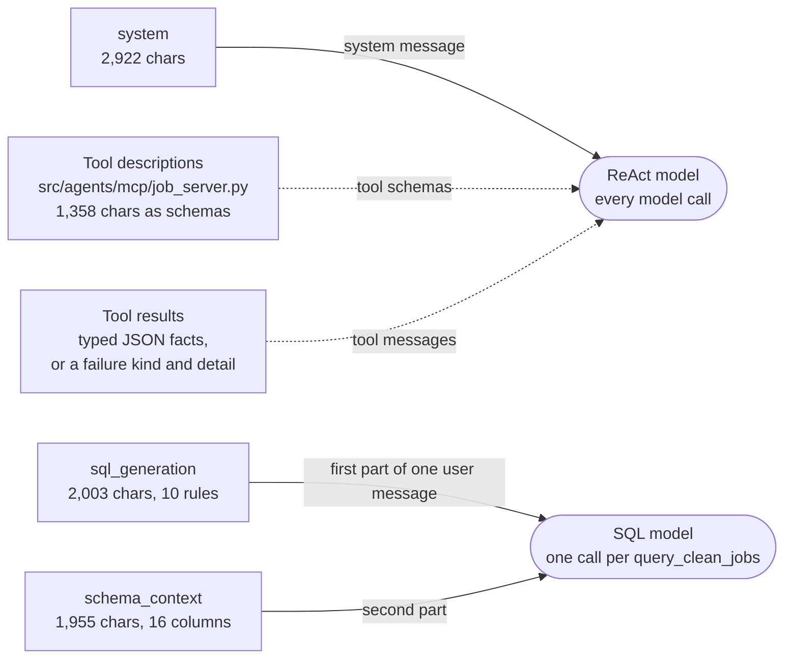
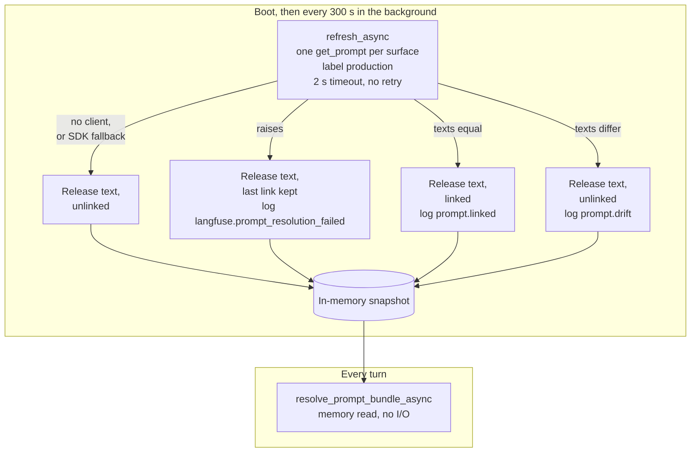

# Prompts module guide

> **Last verified:** 2026-10-25

> **Eviction:** Rewritten whenever `config/prompts.yaml` changes shape, or `src/agents/runtime/prompts.py`, `src/agents/tracing/prompt_registry.py`, `scripts/register_langfuse_prompts.py`, or `agent.prompts` changes, removed when the module is retired.

The prompts module decides which text the models read on each turn, and how a trace names that text.
It is three files: the text and its versions in `config/prompts.yaml`, the per-turn bundle in `src/agents/runtime/prompts.py`, and the registry that serves the text and links it to Langfuse in `src/agents/tracing/prompt_registry.py`.
This guide owns the prompt surfaces, how a turn gets its text, why git is the authority and Langfuse only a link, and how lineage reaches the trace.
It does not own what the tools do with the SQL (row 5 of #617), what else a trace contains (row 6), how agent quality is measured ([the agent behavior baseline](../reference/agent-behavior.md), row 7), or the turn itself ([the runtime guide](runtime.md)).

## 1. Summary and scope

**Five words first.**

- **Surface.** One named prompt text with its own version.
  There are three: `system`, `schema_context`, and `sql_generation`.
  Each has a YAML key under `prompts:` and a Langfuse name, such as `resumi-system`.
- **Release text.** The YAML text shipped in the image, and the only text a model ever reads.
  Its version is the first 12 hex digits of the SHA-256 of the stripped text, such as `3dad4a794dd5`, so it changes exactly when the text does (#700).
- **Link.** A Langfuse prompt version attached to a generation, so the trace points at a registered, immutable copy of the text.
  A surface is linked only while the Langfuse version at the `production` label has exactly the release text.
- **Bundle.** One turn's three surfaces, a `ResolvedPromptBundle`.
  It is read from memory once when the turn starts and held in a `ContextVar`, so the SQL tool sees the same text as the ReAct model.
- **Drift.** The labelled Langfuse version and the release text differ.
  The release text still serves; the surface goes unlinked and the registry logs `prompt.drift`.

**What it owns.**

- The three surfaces, their text, and their content-hash versions.
- Serving the release text from memory, with no Langfuse call on a turn.
- Linking each surface to Langfuse at boot and on a background refresh, and reporting drift.
- One bundle per turn, shared by the ReAct model and the SQL tool.
- The prompt lineage the tracing layer attaches to a trace.
- The register script, `scripts/register_langfuse_prompts.py`.

What it deliberately is not:

- **Not the tool contract.** The tool descriptions in `src/agents/mcp/job_server.py` and the typed results they describe belong to row 5, although the model reads them on every call (section 2).
- **Not the measurement.** Whether a prompt is good is decided by the #708 baseline, described in [the agent behavior baseline](../reference/agent-behavior.md); this module only makes sure the measured text is the served text.
- **Not the agent.** The runtime compiles one agent per system prompt; see [the runtime guide](runtime.md), section 7.

## 2. What the model reads

Captured from the LiteLLM request bodies of real turns on 2026-10-20, against DeepSeek and a copy of the 367-row production snapshot that the #708 baseline uses.
Solid arrows are the governed surfaces: versioned, registered in Langfuse, and named in the trace.
Dashed arrows are text the model also reads that has no version of its own.



| Text | Read by, when | Versioned | In Langfuse | Named in the trace | Guarded by tests |
|---|---|---|---|---|---|
| `system` | The ReAct model, as the system message on every call | Content hash | `resumi-system` | Tag and native link | `tests/test_prompt_surface.py` inventory |
| `sql_generation` | The SQL model, first part of its one user message | Content hash | `resumi-sql-generation` | Tag and native link | Its column list matches `schema_context` and the model (`tests/test_prompt_consistency.py`) |
| `schema_context` | The SQL model, after `sql_generation` | Content hash | `resumi-schema-context` | Tag only | Its column list matches the model |
| Tool and argument descriptions | The ReAct model, as tool schemas on every call | No | No | No | The inventory compares them with what the real MCP server serves |
| Tool results | The ReAct model, as tool messages | No (a typed contract) | No | As tool output | The inventory forbids a written sentence in a tool behaviour module |

**What changed in October 2026.**
On 2026-10-19 all three surfaces were rewritten from scratch for the #708 MVP baseline.
`system` went from 4,820 to 2,459 characters, and `sql_generation` from 29 rules in 6,325 characters to 8 rules in 1,618.
The canonical values and Vietnamese aliases, such as "Hà Nội" = Hanoi or "kỹ sư AI" = AI Engineer, moved from SQL rules into the `schema_context` column guide, which grew from 1,571 to 1,955 characters.
On 2026-10-20 pagination added three `system` rules on reading a later page and two `sql_generation` rules, `OFFSET N` for a next page and `ORDER BY ... id` on every list, which brought them to 2,922 and 2,003 characters (#732).
A one-tool turn now reads about 9,900 characters of instructions, excluding the tool schemas: `system` twice and the SQL message (about 4,020) once, where it read about 17,500 before the rewrite.

**There is no glossary any more.**
Until [ADR-0062](../decisions/adr-0062-tools-return-facts-the-prompt-owns-wording.md) (#702), the tools appended fixed Vietnamese caveat sentences from a `behavior_glossary` block, and one of them made the model deny that columns such as `location` exist.
The tools now return facts: `query_clean_jobs` returns `sql`, `columns`, `rows`, `row_count`, and `total_rows`, and `get_job_details` returns `jobs`, `not_found`, and `not_fetched`.
The `# Reading tool results` section of `system` says what each fact means for the answer.
So the system prompt owns every user-facing word, and a prompt edit is a behaviour change with no code safety net.

**How the SQL model's message is built.**
`src/services/query/generator.py` joins `sql_generation`, a blank line, `schema_context`, a blank line, and `Question: …`.
The SQL model never sees the conversation, only the ReAct model's standalone rewrite of the request.
For "Liệt kê các việc Data Analyst ở Hà Nội" it wrote `WHERE role = 'Data Analyst' AND location ILIKE '%Hanoi%' ORDER BY id`, which uses the canonical role, the city alias from the column guide, and the id tiebreaker.
For the follow-up "Xem thêm" the ReAct model rewrote the request as "..., sắp xếp theo id, bỏ qua 20 tin đã hiển thị, lấy 20 tin tiếp theo", and the SQL model added `LIMIT 20 OFFSET 20`.

## 3. How a turn gets its text

The text never comes from Langfuse.
What the registry fetches is only the link, and it fetches it off the request path.



**Boot.**
`prepare_native_prompts_startup`, called from the serving lifespan before the runtime is built, runs `PromptRegistry.refresh_async`.
It fetches the three surfaces in parallel on worker threads, each bounded by `agent.prompts.fetch_timeout_seconds` (2 s) and never retried.
It publishes the result as a new snapshot and logs `langfuse.prompts_prefetched` with the versions and a `linked` flag per surface.

**Background.**
`refresh_prompt_links_forever` repeats the refresh every `agent.prompts.refresh_interval_seconds` (300 s).
A refresh moves a link and never the text, and a failed refresh is logged and never ends the loop.

**A turn.**
`AgentRuntime.astream` calls `resolve_prompt_bundle_async`, which reads the snapshot; 200 reads took at most 0.7 ms.
The bundle is then entered with `prompt_bundle_context`, a `ContextVar` every nested call reads.
`query_clean_jobs` runs behind an in-process MCP call that carries no request object, so `load_sql_generation_prompt_resolution_async` and `load_schema_context_resolution_async` read the active bundle instead of the registry.

| Part | Why it exists | What breaks without it |
|---|---|---|
| Release text always serves | The text that is reviewed, tested, measured by the baseline, and shipped in the image is the text users get | Two authorities drift apart: from 2026-08-27 to 2026-10-18 production served August text the tests no longer checked (#669) |
| A link only on an exact text match | A generation can never claim a Langfuse version the model did not read | A trace would name a version with different text |
| No Langfuse call on a turn | An unreachable Langfuse costs boot one bounded wait and a turn nothing | Every turn waited 16.1-16.7 s during an outage (#698) |
| One fetch, never retried | Boot waits at most one timeout per surface; the next interval is the retry | The SDK default, 5 s and 2 retries, put 16 s back on boot |
| A whole new snapshot per refresh | A concurrent turn reads either the old snapshot or the new one, never half of each | A turn could mix links from two refreshes |
| One bundle per turn, in a `ContextVar` | The ReAct call and the SQL call inside the tool read the same bundle | The SQL tool would resolve on its own |
| One agent per (version, text) | `create_agent` bakes the system prompt in; unchanged text reuses the cached agent | Every turn would recompile, or a new release text would be ignored |
| An explicit label, never `latest` | Saving a version in the Langfuse UI changes nothing, not even the link | A draft would become the trace's reference |

The evaluation driver has no background task, so `evals/run.py` calls `refresh_prompt_bundle_async` once at startup instead of reading a snapshot nothing has filled.

## 4. Why git is the authority, and Langfuse only a link

The original design, from #448, made Langfuse the authority: a prompt changed without a deploy, an evaluated version was promoted by moving the `production` label, and the YAML was only a fallback for an outage.
The code implemented it, but the workflow stopped being followed.
From 2026-08-27 the `production` label held that day's text while the YAML changed four times, each change merged with a version bump and passing tests.
A deployment with Langfuse keys, Render included, served the August text, and the tests guarded a text that served only when Langfuse was down.
The same question produced different SQL on the two paths, and only one of them carried a false caveat.

On 2026-10-18 the maintainer decided that the release text always serves and Langfuse only links (#669, shipped in #711).
It gives up changing a prompt without a deploy, which bought little: every merge to `main` deploys to Render, and the #708 baseline measures the YAML on a branch, not a Langfuse version.
In exchange the text has one authority, a rollback is a git revert, and drift can no longer change an answer, only remove a link.

**What it keeps from the old design.**

- **Native links.** Langfuse's per-version metrics and its prompt-to-generation view still work, because a linked generation carries the Langfuse version.
- **Immutable registered copies.** The register script creates a Langfuse version for each text the release ships.
- **Isolation from an outage.** A Langfuse outage now costs less than before: the text never depended on it, and a turn never calls it.

**Measured.**
On 2026-10-19 all three `production` versions had been registered from `d7c6041` and equalled the YAML, so boot logged `prompt.linked` for every surface.
On 2026-10-20, after the pagination change (#732) merged and deployed without a register run, boot logged `prompt.drift` for `system` and `sql_generation`, with both hashes, and `prompt.linked` for `schema_context`.
The new text served, a follow-up page was answered correctly, and the turn's generations carried no link: drift removed the link and nothing else.

## 5. What a trace says

A trace gets tags and metadata when it opens, in `langfuse_request_trace` in `src/agents/tracing/langfuse.py`, from the bundle the runtime hands it.
Each generation gets a native link while it runs, through `langfuse_prompt_attributes`, which propagates the bundle's `PromptClient` around the model call when the surface is linked.

Read back from the Langfuse API for a "Xem thêm" turn on 2026-10-20, with `system` and `sql_generation` in drift:

```text
tags      api:chat-stream  model:deepseek/deepseek-flash  provider:deepseek
          prompt:system:3dad4a794dd5  prompt:schema_context:562d695d7870
          prompt:sql_generation:d06eb911d832
metadata  prompt_versions = {"schema_context": "562d695d7870",
                             "sql_generation": "d06eb911d832",
                             "system": "3dad4a794dd5"}
generations
  decide tool    -> no link (drift)
  write SQL      -> no link (drift)
  write answer   -> no link (drift)
```

On 2026-10-19, with every surface linked, the same three generations linked to `resumi-system` 3, `resumi-sql-generation` 3, and `resumi-system` 3.

- **Tags read the content hash, links read the Langfuse version.**
  The hash is derived from the served text, so it changes exactly when the text does, and nothing is bumped by hand (#700).
  An unlinked generation still has the tag, so the tag is the lineage that always exists.
- **A hash is only comparable with a hash.**
  Traces before #700 carry hand-typed labels such as `prompt:system:v1`, and `v1` named two different texts: the retired v0 prompt and the #708 rewrite.
  Filter older traces by date.
- **`schema_context` is never linked.**
  It is joined into the SQL message, which carries only the `sql_generation` link; it appears as a tag only, even when `prompt.linked` was logged for it.
- **The metadata is JSON.**
  `prompt_versions` is written as a compact JSON string, because the SDK stringifies any non-string metadata value with `str()`; Langfuse parses it back into an object.
  Each hash is 12 hex digits so all three fit the SDK's 200-character metadata limit; `prompt.drift` reports the full digests.

**Eval lineage.**
`evals/baseline_sql.py`, the #708 Layer 1 runner, writes the content hashes into each saved run as `prompt_versions`, so a saved run says which text it measured.
The scenario report written by `evals/run.py` still holds no prompt version; its traces carry the tags above.

## 6. Failure paths

Measured on 2026-10-19 in-process with the real Langfuse SDK 4.15.6, and on a live server for the linked case (2026-10-19) and the drift case (2026-10-20).

| Situation | Text served | Link | Boot | A turn | What tells you |
|---|---|---|---|---|---|
| Langfuse reachable, texts equal | Release | Yes | Refresh 0.48 s | Memory read | `prompt.linked` per surface; `linked` all true |
| `LANGFUSE_ENABLED=false`, or no keys | Release | No | No fetch | Memory read | `linked` all false; no traces |
| A surface edited and deployed, not yet registered | Release, the new text | No, for that surface | Unchanged | Memory read | `prompt.drift` with both hashes |
| A prompt name missing from Langfuse | Release | No, for that surface | One failed fetch | Memory read | `linked` false for that surface |
| Langfuse unreachable at boot | Release | No | Refresh 2.03 s | Memory read | `linked` all false; only the SDK logs its timeouts |
| Langfuse unreachable later | Release | The last link stays | - | Memory read | The SDK logs; the link holds |

**Two things the log does not say.**

- **An outage at boot looks like a missing prompt.**
  With `fallback=` passed, the SDK returns its fallback object instead of raising, so the registry takes the unlinked branch and its own `langfuse.prompt_resolution_failed` line is not written.
  Only the SDK's `Error while fetching prompt … timed out` lines and `linked: false` show it.
- **A later outage keeps the link because of the SDK cache, not the registry.**
  The 60 s cache (`agent.prompts.cache_ttl_seconds`) has always expired by the next 300 s refresh, so the SDK returns the cached version at once and refetches in a background thread (SDK source, not timed).
  The same mechanism means a register run reaches the link on the second refresh after it, up to 10 minutes later.

**The end of the turn no longer waits on Langfuse either.**
The trace URL is built from the project id resolved once at boot, with no I/O on the turn (#699), so an outage no longer ends a finished turn in `provider_busy` at the deadline.

## 7. Behaviours that surprise a new developer

1. **Langfuse cannot change what the model reads.**
   Moving the `production` label, or editing a version in the Langfuse UI, only changes or removes a link.
2. **A deploy before registering is expected drift.**
   Between the merge and the register run, the new text serves unlinked and `prompt.drift` is logged; answers are unaffected.
3. **Production can be in drift for a while without anyone noticing.**
   Nothing runs the register step on deploy, so after #732 merged, `system` and `sql_generation` served unlinked until someone registered them; only a `prompt.drift` warning at boot says so.
4. **The tag and the link use different numbers for the same text:** `3dad4a794dd5` and a Langfuse integer.
5. **`schema_context` is linked in the log but not in the trace** (section 5).
6. **A link takes up to two refreshes to appear** after a register run (section 6).
7. **No code guarantees a hedge.**
   Since ADR-0062, saying "showing 20 of 37" or "matched in the posting text" is a `system` rule, so only the baseline and hand review notice when an edit drops it.
8. **The SQL the model reads in a tool result carries the row cap.**
   A count query arrives as `SELECT COUNT(*) AS count … LIMIT 20`, because `sql` is the statement that ran after bounds; the prompt tells the model never to show it.

## 8. Trade-offs, and what would now be decided differently

**Deliberate, and still right.**

- **Git is the authority** (#669).
  One text is reviewed, tested, measured, and served.
- **Langfuse is a link, kept only on an exact match.**
  A trace can never point at text the model did not read.
- **No network call on a turn** (#698).
  Prompt resolution is a memory read, and Langfuse is touched only at boot and in the background.
- **One bundle per turn, carried in a `ContextVar`.**
  Every model call in a turn reads the same bundle, and the trace names exactly that bundle.
- **Facts from the tools, words from the prompt** (ADR-0062).
  One prompt owns all user-facing wording, so it can be shaped to the question.
- **Small prompts, grown only by measured failures.**
  The rule for adding complexity in [the agent behavior baseline](../reference/agent-behavior.md) requires a rule to fix a failure seen more than once, at the lowest layer that works.

**Would now be decided differently.**

1. **Registering is a manual step after the deploy.**
   A drift window is harmless to answers, but it is open until a person runs the script, and it was open after #732.
   Running `register_langfuse_prompts.py --label production` from the deploy, then `--check`, would shrink it to the refresh lag.
   Not yet tracked.
2. **Nineteen functions for one bundle** (#615).
   `src/agents/runtime/prompts.py` has 19 functions; 11 have no caller outside the module or tests.
   It collapses to reading the bundle, refreshing it, and the context manager.
3. **Prompt resolution lives in `tracing/`.**
   Now that the registry serves text and only links through Langfuse, the text half belongs beside the runtime, and only the link half in tracing.
   `src/agents/runtime/prompts.py` imports the registry from `tracing/`, and `src/agents/tracing/langfuse.py` imports `runtime/prompts.py` back; where it moves is decided with the tracing guide (row 6, #614).
4. **Two caches, and the outer one hides the inner one's errors** (section 6).
   The registry's snapshot already is a cache, with its own keep-the-last-link rule for a fetch that raises, but the SDK's cache and `fallback=` sit underneath it.
   So an outage at boot arrives as an SDK fallback and is silent in the app's log, a later outage keeps the link only through the SDK's stale entry, and a register run takes two refreshes to link.
   Refreshing with `cache_ttl_seconds=0` and no `fallback=`, as the register script already fetches, would make every failure raise into the registry's rule and its `langfuse.prompt_resolution_failed` line, and make one refresh enough.
   Not yet tracked.
5. **`schema_context` has no native link** (section 5).
   Its change is visible only as a tag, and `prompt.linked` for it promises a link no generation carries.
   Either link the SQL generation to both prompts, or stop registering `schema_context` and say so in the boot line.
   Not yet tracked.

## 9. Changing a prompt safely

1. **Decide whether a rule is needed at all.**
   Follow the rule for adding complexity in [the agent behavior baseline](../reference/agent-behavior.md): a failure seen more than once, fixed at the lowest layer that works.
   A column meaning or a Vietnamese alias goes in `schema_context`, a fact in a tool result, and a `system` or `sql_generation` rule last.
2. **Edit the text** in `config/prompts.yaml`, and say in the commit message what changed and why.
   Nothing is bumped: the version is the content hash, so the trace lineage changes with the text.
3. **Run the prompt tests:** `uv run pytest tests/test_prompt_consistency.py tests/test_prompt_surface.py tests/agents -q`.
4. **Measure on the branch.**
   For `sql_generation` or `schema_context`, run Layer 1: `evals.baseline_sql generate` sends each first-turn question through the product's own `generate_sql` once and saves the SQL with the prompt hashes, and `score` compares it with the reference SQL on the snapshot without a model call.
   Layer 1 never reads `system`, so for a `system` change run the Layer 2 cases and review them by hand; no code guarantees a hedge.
   The commands are in [the evaluation README](../../evals/README.md).
5. **Merge, and let Render deploy.**
   Until the next step, the new text serves unlinked and `prompt.drift` is logged.
6. **Register:** `uv run python scripts/register_langfuse_prompts.py --label production`, then `--check`, which exits non-zero on drift, a missing version, or an unreadable lookup.
   The link appears within two refresh intervals, or at the next boot.

The full operator procedure, including a `candidate` run in an isolated Langfuse project, is in [the prompt management how-to](../how-to/manage-langfuse-prompts.md).

**Roll back.**
Revert the prompt commit, deploy, and register again; the content hash returns with the text.
The register run creates a new Langfuse version holding the restored text and moves `production` to it, so the link comes back under a new number.

**Change a tool description.**
Edit the constants in `src/agents/mcp/job_server.py`.
The model reads them on every call and they have no version, so `tests/test_prompt_surface.py` fails until the inventory records the new text, and the change shows in a trace only as different tool calls.

**Add a surface.**
Add a `PromptDefinition` in `src/agents/tracing/prompt_registry.py`, a field on `ResolvedPromptBundle`, and the YAML text, and record it in the `tests/test_prompt_surface.py` inventory.
The register script reads its names from `LANGFUSE_PROMPT_NAMES`, so it picks the surface up without a change.
An unregistered surface serves unlinked and costs nothing on a turn.

## 10. Code map

| Start here | For |
|---|---|
| `config/prompts.yaml` → `prompts` | The release text |
| `config/settings.yaml` → `agent.prompts` | The label, the cache lifetime, the fetch timeout, and the refresh interval |
| `src/agents/tracing/prompt_registry.py` → `PromptRegistry.resolve`, `PromptRegistry.refresh_async`, `PromptRegistry._refresh_surface`, `PromptRegistry._release` | The in-memory snapshot, the content-hash version, the link, and drift |
| `src/agents/tracing/langfuse.py` → `prepare_native_prompts_startup`, `refresh_prompt_links_forever` | Boot resolution and the background refresh |
| `src/agents/runtime/prompts.py` → `resolve_prompt_bundle_async`, `refresh_prompt_bundle_async`, `prompt_bundle_context`, `ResolvedPromptBundle` | One bundle per turn, and the eval driver's own refresh |
| `src/agents/runtime/react_agent.py` → `AgentRuntime.astream`, `AgentRuntime._active_agent` | Where a turn reads its bundle, and the agent cache per system prompt |
| `src/agents/tools/query_clean_jobs.py` → `generate_sql`; `src/services/query/generator.py` → `generate_sql` | How the SQL model's message is built |
| `src/agents/tracing/sql_generation.py` → `TracedSqlGenerationModel` | How the SQL model's call is linked to its prompt |
| `src/agents/mcp/job_server.py` → `QUERY_CLEAN_JOBS_DESCRIPTION`, `GET_JOB_DETAILS_DESCRIPTION` | The tool text the model reads |
| `src/agents/tracing/langfuse.py` → `langfuse_request_trace`, `langfuse_prompt_attributes` | Tags, metadata, and native links |
| `scripts/register_langfuse_prompts.py` → `synchronize_prompts`, `check_prompt_drift` | Registering a release and checking drift |
| `evals/baseline_sql.py` | Layer 1 of the baseline, which records the prompt hashes it measured |
| `tests/test_prompt_consistency.py`, `tests/test_prompt_surface.py`, `tests/agents/test_langfuse_prompt_reference.py`, `tests/agents/runtime/test_prompts.py`, `tests/api/test_native_prompt_chat.py`, `tests/scripts/test_register_langfuse_prompts.py` | The behaviour pinned by tests |
| [ADR-0062](../decisions/adr-0062-tools-return-facts-the-prompt-owns-wording.md), [the agent behavior baseline](../reference/agent-behavior.md), [the prompt management how-to](../how-to/manage-langfuse-prompts.md) | Why tools return facts, how prompts are measured, and the operator procedure |
