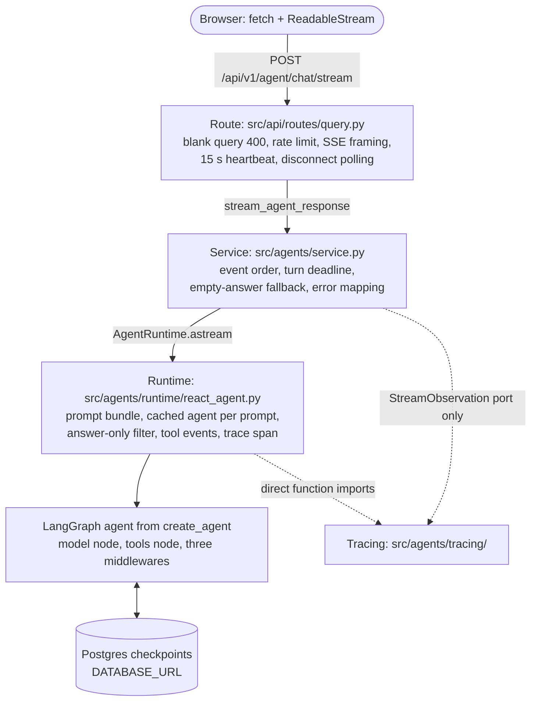
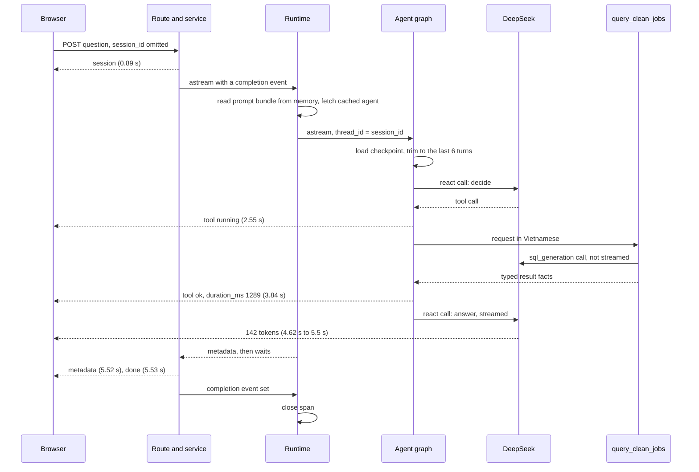
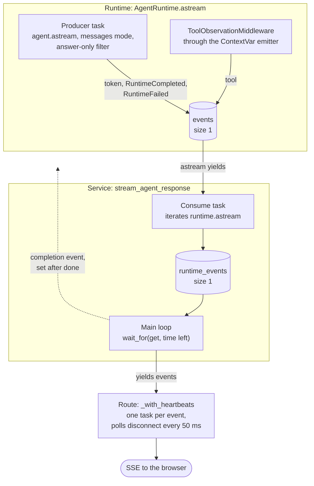

# Runtime module guide

> **Last verified:** 2026-10-18

> **Eviction:** Rewritten whenever `src/agents/service.py`, `src/agents/runtime/react_agent.py`, `src/agents/runtime/middleware.py`, `src/agents/runtime/tool_events.py`, `src/agents/runtime/factory.py`, or `agent.memory` changes; removed when the module is retired.

The runtime is what happens between a question arriving and the last streamed event leaving.
It spans three layers: the route speaks HTTP and SSE, the service owns the event order and the turn deadline, and the runtime runs the LangChain agent against a Postgres-backed conversation.
This guide owns one turn end to end, the stream machinery, conversation memory, and what each failure leaves behind.
It does not own what the prompts say (row 4 of #617), what the tools do (row 5), what a trace contains (row 6), or which model serves ([the model config guide](model-config.md)).

## 1. Summary and scope

**Four words first.**

- **Turn.** One user question and everything the agent does to answer it: model calls, tool calls, and the final answer.
  In the stored thread a turn starts at a `HumanMessage`.
- **Session, or thread.** One conversation.
  The API's `session_id` is passed to LangGraph as `thread_id`.
  The browser pins it from the first `session` event and sends it on every later turn until the page reloads.
- **Checkpoint.** A saved copy of the thread's state, its message list, written to Postgres by `AsyncPostgresSaver` after every graph step.
  A two-turn session wrote 22 checkpoint rows.
- **Middleware.** A hook that LangChain's `create_agent` runs around each model or tool call.
  There are three: interrupted-tool-call repair, turn trimming, and tool observation.

**What it owns.**

- The six public stream events and their order: `session` first, `done` last, always.
- The typed event contract: the six public models in `src/agents/models.py`, which the runtime and the service yield and the API publishes as `STREAM_EVENT_SCHEMA` (#679).
- The 120 s turn deadline (ADR-0048) and the empty-answer fallback.
- Mapping a failure to `provider_busy` or `internal_error`; the classification itself is described in [the model config guide](model-config.md), section 5.
- Compiling one agent per system prompt version and caching it.
- Streaming only the model's answer text, never tool output, SQL, or tool-call plumbing.
- Publishing tool calls as `tool` events while they run.
- Conversation memory: what is stored, and what the model sees.

What it deliberately is not:

- **Not transport.** Rate limits, the blank-query 400, SSE framing, heartbeats, and disconnect detection are the route's (`src/api/routes/query.py`).
- **Not boot.** The checkpointer, the tool list, and `AgentRuntime` itself are built by [composition](composition.md).
- **Not the tools.** The runtime runs whatever tools composition discovered; `query_clean_jobs` and `get_job_details` are row 5's.
- **Not tracing.** It opens one Langfuse span per turn through the tracing layer's functions; what is recorded is row 6's.

## 2. The layers, and why the runtime is one of them

Each layer knows only the one below it.
The route never imports LangChain, and the service imports neither LangChain nor Langfuse.
That is the rule in `AGENTS.md` section 1, and it is what lets the deadline and the event order be tested with a fake runtime (`tests/agents/test_service.py`).



| Layer | Owns | Knows nothing about |
|---|---|---|
| Route | Rejecting a blank query with 400; the per-IP rate limit (`api.rate_limit`); SSE encoding with `type` in every payload; a `: ping` comment after 15 s of silence (ADR-0050); noticing a disconnect and closing the service generator (ADR-0049) | Agents, prompts, models |
| Service | Minting a `session_id` when the request has none; the event order; the deadline; the fallback token; mapping exceptions to an in-band `error` event; folding that stream into the JSON body for `/chat` | LangChain, Langfuse, the graph |
| Runtime | Reading the turn's prompt bundle from memory (resolved once at boot and refreshed in the background, #698); the per-prompt agent cache; the answer-only filter; binding the turn's tool-event emitter; the Langfuse span | HTTP, SSE, the deadline |

**Where the split leaks today.**

1. The runtime calls four functions from `src/agents/tracing/langfuse.py`, while the service reaches tracing only through the vendor-neutral `StreamObservation` port.
   Whether the runtime should sit behind a port too is decided in the tracing guide (row 6).
2. The route imports `src.agents.tracing.stream` for its no-op default observation.

## 3. One turn, measured

A real turn on the served v1 bundle, against DeepSeek and a copy of the eval fixture database, with Langfuse disabled.
Measured on 2026-10-16/17 on a local Windows machine, so the absolute latencies are indicative.
The runtime files are unchanged between the measured source and `778becc`.



The question was "Có việc thực tập Python nào ở Hà Nội không?".
The user sees the `session` event pin the conversation, then a tool card with "đang chạy…", then the answer streaming, then the trace link.
Before the first token, the placeholder reads "Đang đọc các tin tuyển dụng…".

**Three model calls, one visible.**
The `react` model decides to call the tool, `query_clean_jobs` calls the `sql_generation` model to write SQL, and the `react` model writes the answer.
Only the last call streams to the user.
A listing question costs more: in one run on `778becc`, "Liệt kê chi tiết tất cả các tin tuyển dụng ở Hà Nội" called `query_clean_jobs` once and then `get_job_details` in four separate steps, six `react` calls in all, and its first token arrived after 5.5 s.

**The six events.**

| Event | Payload | When |
|---|---|---|
| `session` | `session_id` | First, before the agent runs |
| `tool` | `name`, `status` (`running`, `ok`, `error`), `call_id`, `arguments`, `duration_ms`, `error`, `row_count`, `truncated` | When each tool call starts and ends, interleaved with tokens |
| `token` | `text` | Each chunk of answer text, many |
| `metadata` | `trace_id`, `trace_url`, `answer_source` (`model` or `fallback`) | Once, after the last token; never on a failed turn |
| `error` | `message`, `code`, `retryable` | In place of further tokens when the turn fails |
| `done` | nothing | Always last |

A successful turn is `session`, any `tool` and `token` events, `metadata`, `done`.
A failed turn is `session`, whatever arrived before the failure, `error`, `done`.
`metadata.answer_source` is `fallback` when the service injected the empty-answer sentence, and `model` otherwise.
The web client keys the no-answer card on that field, never on the fallback text.
The published schema is `STREAM_EVENT_SCHEMA` in `src/api/schemas.py`, built from the models in `src/agents/models.py`; [the architecture document](../architecture.md), section 4.2, records why SSE and why `session` comes first.

**The answer-only filter.**
The runtime streams with `stream_mode="messages"` and keeps a chunk only if it comes from the `model` node, has non-empty string content, and carries no tool-call chunks.
The node gate drops tool output and the nested SQL writer's text, because both run under the `tools` node.
The tool-call gate drops the plumbing of a tool request.
Tool calls reach the user only through `tool` events, whose arguments are flattened to at most six short strings (`format_arguments`).

## 4. Inside the stream

This is the hardest part of the module to read, and the part most likely to be "simplified" wrongly.
Three tasks and two queues of size 1 sit between the model and the socket, and each exists for a reason.



| Part | Why it exists | What breaks without it |
|---|---|---|
| Producer task and queue in the runtime | Tool events come from middleware deep inside the graph, while tokens come from the stream; both must reach the user in real time and in order | Tool cards would arrive after the answer |
| Internal signals (`RuntimeCompleted`, `RuntimeFailed`) | The producer's end-of-stream marker and its failure channel share the queue with tokens so a turn stays in one order, but they are not public events: the service consumes them and never forwards one | A finished turn and a failed one would look the same to the service, and a failure would have to be smuggled into a public frame (#679) |
| `ContextVar` emitter (`bind_tool_event_emitter`) | The compiled agent is cached and shared across turns, so its middleware cannot hold per-turn state; the binding is copied into the producer task when it is created | A concurrent turn could receive another turn's tool events |
| Result holder (`ToolResultFacts`) | A tool may run in a copied context, where a `ContextVar` rebinding is invisible to the middleware; a shared mutable holder survives that | The tool card would lose its `row_count` |
| Consume task and queue in the service | The deadline waits on a queue, not on the generator; cancelling a wait on a queue is safe, cancelling an async generator mid-step is not | An expired deadline could hang in generator cleanup, which ADR-0048 forbids |
| Completion handshake (`completion_event`) | The runtime yields `metadata`, then keeps the Langfuse span open until the service has sent `done` | The span would close before the stream finished, and the recorded completion latency would be wrong |
| Queues of size 1 | Backpressure: the model is never read faster than the browser receives | A slow or vanished client could leave a backlog of events in memory |

The span's completion is recorded on the service's side of `done`, and the turn does no Langfuse I/O after that (#699).
The trace URL is composed from the project id resolved once at startup, and export is left to the SDK's background span processor; the process drains whatever is left through `shutdown_langfuse` at shutdown.

The handshake is the only way to drive `astream`: `completion_event` is required, and the runtime never completes an observation itself.

## 5. Memory: what is stored, and what the model sees

Two bounds, configured under `agent.memory` in `config/settings.yaml` and validated once at load into `settings.agent`:

```yaml
agent:
  memory:
    max_turns: 6
    retention_days: 30
```

- **Stored.** `AsyncPostgresSaver` keeps the whole thread in the application database, through `DATABASE_URL` (the owner role, not the read-only agent role).
  The stored thread is never rewritten, except to answer an interrupted tool call (section 6).
  Each turn replays the stored messages; there is no other memory code, and refining a question is the model reading its own earlier turns.
- **Seen.** `TrimTurnsMiddleware` wraps each model call and cuts its input to the last 6 complete turns, counting a turn from each `HumanMessage`.
  It changes only the request, never storage.
- **Kept.** The serving process deletes every thread whose newest checkpoint is older than `retention_days`, with its blobs and writes, once at boot and then daily (#673).
  Deletion is the only storage bound, and it is by age, never by rewriting what a thread holds.

Driving the real middleware stack with a recording model that calls one tool per turn:

| Turn | Stored messages after the turn | Model sees |
|---|---|---|
| 1 to 6 | 4 to 24 | Every turn so far |
| 7 to 16 | 28 to 64 | The last 6 turns |

So the model's memory is a sliding window of 6 turns, and a live thread grows by at least 4 messages per tool-using turn with no cap; the retention sweep is what bounds how long that thread is kept (#673).
A thread compacted before #672 keeps its summary message, which now counts as one turn and ages out of the window.

**Why there is no compaction.**
Until #672 (2026-10-17), LangChain's `SummarizationMiddleware` also rewrote storage once a thread held 48 messages, keeping the last 12 behind one summary.
It counted messages while the trim counted turns, so with tool-using turns the model dropped from 6 verbatim turns to about 3 when it fired.
Its prompt was LangChain's English template for coding agents, outside prompt management, and the message-count cut could split a question from its answer: a live summary called an answered question still open and told the model to repeat the tool call.
It also added a silent model call of about 2 s.
A demo session rarely exceeds 6 tool turns, so #672 removed it rather than govern a second prompt.

**What else is true of the stored thread.**

- Only the retention sweep deletes a thread.
  A browser reload starts a new session, and the abandoned thread is deleted by the sweep once its newest checkpoint is older than `retention_days` (#673).
- A turn stopped after its first token keeps the tool calls and results but not the partial answer, so the model does not know what the user saw.
  ADR-0049 accepts that: no partial-response persistence.
- A turn stopped while a tool runs keeps a tool call with no result; before the next model call a synthetic tool message answers it, so the session keeps working (section 6, #671).

## 6. Failure paths

Each row was run against a live server.
The last column is the one that matters: does the conversation still work afterwards?

| Situation | The user sees | Stored afterwards | Next turn in that session |
|---|---|---|---|
| Normal turn | `session`, `tool` events, tokens, `metadata`, `done` | The whole exchange | Works |
| Dừng, or the tab closes, while a tool runs | On Dừng the turn reads as stopped: "Đã dừng." where the answer would be, and the tool card flips to "đã dừng"; a closed tab sees nothing more | Question and tool call, no tool result | Works; the repair answers the call before the model sees it (#671) |
| Deadline expires while a tool runs | `provider_busy`, "Bản thử nghiệm đang bận - vui lòng thử lại sau một lát.", `retryable: true` | Question and tool call, no tool result | Works; the promised retry goes through (#671) |
| Deadline expires after the tool returned | `provider_busy`, `retryable: true` | Question, tool call, result | Works |
| Dừng after the first tokens | The partial answer as painted, with "Đã dừng." above it, shown and announced alike | Tool calls and results, no answer | Works |
| Two turns at once on one session | Both answered | Only the later turn's exchange | Works, but one exchange is silently lost |
| The model answers nothing | One Vietnamese fallback sentence ([ADR-0061](../decisions/adr-0061-user-facing-copy-is-server-owned-vietnamese.md)), and `metadata.answer_source` is `fallback` | Whatever the model wrote | Works |

**How each path ends.**

- **Error.** An exception in the producer becomes an internal `RuntimeFailed` signal, which the service consumes and never forwards; the runtime then waits on the completion handshake while the service classifies the exception, yields `error` and `done`, and skips `metadata`.
- **Deadline.** The service waits for each event with `asyncio.wait_for` and the time left.
  On expiry it cancels the runtime task and detaches it instead of awaiting its cleanup, then yields `provider_busy` and `done`.
  The deadline can also pass while the route is suspended at a `yield`, that is, while it is still sending the previous event, which a slow consumer makes likelier.
  That exit cancels and detaches the runtime task too, so no path awaits a runtime that can be blocked on the full queue.
  A slow-consumer test pins that the generator finishes right after `done` (#688).
- **Disconnect.** The route polls `request.is_disconnected` every 50 ms while it waits for each event, then closes the service generator.
  The service records the outcome as cancelled, sets the handshake, cancels the runtime task, and awaits it; the runtime cancels its producer and closes its span without any Langfuse I/O (#699).
  It logs `stream.client_disconnected` once, naming the session id the service issued, and only when the client left before `done` (#674).
- **A tool call interrupted mid-flight.**
  LangGraph checkpoints after the model asks for a tool and before the tool answers, so a stopped turn leaves a call with no result.
  Before each model call, `InterruptedToolCallRepairMiddleware` inserts one synthetic error `ToolMessage` per unanswered id, directly after the call, and writes the repaired list to storage.
  The model can retry the call or move on from a valid sequence, so the Dừng button, a disconnect, the deadline, and a worker crash all leave the session working (#671).
  A thread a previous interruption already damaged is repaired the same way on its next model call, so no migration is needed.

**The non-streaming route.**
`POST /api/v1/agent/chat` is not a second path: `collect_agent_response` drives `stream_agent_response` and folds its events into the JSON body (#689).
It is bounded by the same `agent.stream_turn_timeout_seconds`, and the `error` event decides the status: a `provider_busy` event becomes the route's retryable `503` with the busy message, `429` when the provider rate-limited the turn, and any other failure becomes its generic `500`.
The status the JSON route needs rides the internal `status_code` field on the event, which the SSE route strips, so the published payload is unchanged.
The web client and the eval driver do not use the route; the API contract keeps it for clients that need a finished JSON body.

## 7. Behaviours that surprise a new developer

1. **A repaired thread carries a tool message the tool never produced.**
   After a turn is interrupted mid-tool, the next turn stores one synthetic error `ToolMessage` per unanswered call, so the sequence a provider validates stays complete (section 6, #671).
2. **The first request after a prompt change is slower.**
   `AgentRuntime._active_agent` compiles one agent per system prompt version and content and caches it for the process lifetime; the cache is never evicted.
3. **The empty-answer fallback is a `token`, not an `error`.**
   A turn whose model writes nothing still succeeds, with one Vietnamese fallback sentence as its answer (ADR-0061).
   The following `metadata` frame carries `answer_source: "fallback"`, which is the machine-readable signal clients use to show the designed no-answer card instead of matching the sentence.
4. **A failed turn has no trace link.**
   The `error` path skips `metadata`, although the trace exists.
5. **Two turns at once on one session lose an exchange.**
   Both read the same checkpoint and the later write wins.
   The web UI cannot trigger this: the composer is locked during a turn, and each page has its own session.
   An API client can, and that is recorded as a known limit (section 8).
6. **Every completed stream is logged as a client disconnect** (#674), and a first turn's disconnect carries `session_id: null`, because the log names the request's id, not the one the service minted.
7. **The tool card's count is a number of matching records, and only when one exists.**
   A count query publishes the number it counted, so the card and the answer agree; every other aggregate result, such as an average or a per-group count, publishes no count at all and the card shows only the duration (#677).
8. **The heartbeat is not an event.**
   `: ping` is an SSE comment, so clients and the event order never see it (ADR-0050).

## 8. Trade-offs, and what would now be decided differently

**Deliberate, and still right.**

- **Three layers for one request.**
  The route can change transport and the runtime can change framework without touching the service, and the service's deadline and error policy are tested with a fake runtime.
- **One serving path** (#689).
  `/chat` folds the stream instead of reimplementing it, so the deadline, the fallback, and the error mapping exist once; the JSON body is a view of the same events.
- **Typed events end to end** (#679).
  The six public models live in `src/agents/models.py`, the runtime and the service yield them, and the route serialises them, so no layer builds its own dict and mypy checks the stream from the producer to the frame.
- **`session` first.**
  The client pins the conversation before the agent runs, at the cost that every failure after it must be in-band, since the 200 is already sent.
- **Tasks and queues instead of cancelling the generator** (section 4, ADR-0048).
- **Tool observation never intervenes.**
  `ToolObservationMiddleware` reports a call and lets every exception propagate unchanged, so telemetry cannot break a turn.
- **No partial-answer persistence** (ADR-0049).
  A stopped answer is not stored, so a stop never writes half a sentence into memory.
- **Memory in the application database**, so a conversation survives a restart and works across instances, never in Langfuse's database.
- **One bound on what the model sees, counted in turns** (#672).
  A turn is the unit a follow-up refers to, so the window never splits a question from its answer, and no unmanaged prompt rewrites a user's history.
- **Storage is bounded by deleting threads, not by rewriting them** (#673).
  A thread whose newest checkpoint is older than `agent.memory.retention_days` loses all its rows, so removal is a whole-conversation operation a live thread never notices.
- **No per-session serialisation.**
  A per-session lock would be cheap with one web worker but would do nothing across instances, and the only client that matters cannot send two turns at once.

**Would now be decided differently.**
Each item was found while preparing this guide and is tracked by an issue.

1. **The runtime imports tracing directly.**
   Not decided here: the tracing guide (row 6) decides whether the runtime goes behind a port like the service.

#706 (the count as the model reads it, row 5) is the remaining item in this area.

## 9. Changing it safely

**Add or change a stream event.**
The SSE wire format is a public contract: event names, payload fields including `type`, and order.
Change `src/agents/models.py` (the six models and the `StreamEvent` union), the service or runtime that emits it, and `src/api/static/app.js` together, and extend `tests/api/test_stream.py`, whose schema tests check every frame against `STREAM_EVENT_SCHEMA` and whose recorded-turn test pins the frames a real turn writes.
The empty-answer outcome is `metadata.answer_source`; the client must not match `FALLBACK_ANSWER`, and a change to that field updates the model, the service, the client, and the tests together (#693).
A new internal signal must never reach the route: an internal event may carry extra fields its consumers need, such as the `status_code` the JSON route maps to an HTTP status, but the route writes the public projection (`InternalStreamError.as_public_event()`) before encoding the frame (#689).

**Add a middleware.**
Order matters: `agent_factory` lists interrupted-tool-call repair, then trimming, then tool observation, which stays innermost so it reports the call as actually issued.
A middleware that returns state from `before_model`, such as the repair, changes storage; one that wraps the model call, such as trimming, changes only what the model sees.
Per-turn state must come through a `ContextVar` bound by the runtime, never a middleware attribute, because the agent is shared across turns.

**Change a memory bound.**
Count in turns, not messages, and check a 16-turn tool-using session, as in section 5 (`tests/agents/runtime/test_memory.py`, `tests/agents/runtime/test_trimming.py`).

**Change the deadline or the heartbeat.**
The deadline is `agent.stream_turn_timeout_seconds`; keep it above one model call's worst case, as [the model config guide](model-config.md) section 5 explains.
The heartbeat, `api.stream_heartbeat_seconds`, must stay below the proxy idle window.

**Upgrade LangChain or LangGraph.**
Re-confirm three things the runtime assumes: the answer comes from a node named `model`; tool-call requests ride chunks with `tool_call_chunks`; and a checkpoint is written between the model's tool request and the tool's result.
`tests/agents/runtime/test_tool_event_stream.py` runs a real graph and fails if the node name changes.
The leak test, `test_astream_does_not_leak_tool_calls_sql_or_raw_tool_output` in `tests/agents/runtime/test_react_agent.py`, feeds the filter fake node names, so it does not catch a rename; confirm the tool-call gate with one live turn whose tokens contain no SQL and no tool name.

**Touch the stream machinery.**
Run `uv run pytest tests/agents tests/api`, then stop a turn in the web UI while a tool runs and ask again; expected a normal answer.

## 10. Code map

| Start here | For |
|---|---|
| `src/api/routes/query.py` → `stream_query_agent`, `_with_heartbeats`, `_DisconnectLoggingEventSourceResponse` | SSE framing, heartbeats, disconnects |
| `src/agents/service.py` → `stream_agent_response` | Event order, deadline, fallback, error mapping |
| `src/agents/service.py` → `collect_agent_response` | Folding that stream into the JSON route's body |
| `src/agents/runtime/react_agent.py` → `AgentRuntime.astream`, `_active_agent` | The answer-only filter, the agent cache, the handshake |
| `src/agents/runtime/factory.py` → `agent_factory` | How the agent and its middleware are assembled |
| `src/agents/runtime/middleware.py` → `InterruptedToolCallRepairMiddleware`, `TrimTurnsMiddleware`, `ToolObservationMiddleware` | The interrupted-call repair, the memory bound, and tool events |
| `src/agents/runtime/tool_events.py` → `bind_tool_event_emitter`, `emit_tool_event`, `publish_tool_result` | The tool-event seam |
| `src/core/checkpointer.py` → `build_checkpointer` | Where memory is stored |
| `src/core/errors.py` → `classify_provider_busy_error`, `BUSY_MESSAGE`, `GENERIC_ERROR_MESSAGE` | What a failure becomes |
| `src/agents/tracing/stream.py` → `StreamObservation` | The service's only view of tracing |
| `src/agents/models.py` → `StreamEvent`, `RuntimeCompleted`, `RuntimeFailed` | The six public event models, the union the API publishes, and the internal signals |
| `src/api/schemas.py` → `STREAM_EVENT_SCHEMA` | The published event contract, built from that union |
| `tests/agents/test_service.py`, `tests/agents/runtime/test_react_agent.py`, `tests/agents/runtime/test_tool_event_stream.py`, `tests/api/test_stream.py`, `tests/api/test_stream_disconnect.py`, `tests/api/test_conversation.py` | The behaviour pinned by tests |
| [ADR-0048](../decisions/adr-0048-streamed-agent-turn-serving-deadline.md), [ADR-0049](../decisions/adr-0049-cancel-streamed-generation-on-client-disconnect.md), [ADR-0050](../decisions/adr-0050-sse-comments-keep-silent-streams-alive.md) | Why the deadline, the disconnect cancellation, and the heartbeat |
