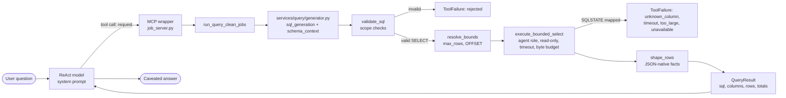

# Tools and query module guide

> **Last verified:** 2026-10-25

> **Eviction:** Rewritten when the tool surface, `src/services/query/`, the `clean_jobs` contract, or either boot guard changes shape, removed when the read-only query path is retired.

The tools-and-query module turns a natural-language question into one validated, bounded, read-only SQL statement against `clean_jobs`, and turns the rows back into typed facts the agent can describe.
It also owns what the model can see and touch: the 16-column contract, the least-privilege agent role, and the two boot guards that enforce both.
It does not own the prompt text ([the prompts guide](prompts.md)), the ReAct loop ([the runtime guide](runtime.md)), or the evaluation datasets (row 7 of #617).

## 1. Summary and scope

**Five words first.**

- **Request.** One standalone question in the user's language, restating every filter from earlier turns that still applies.
  The agent writes it; the tool does not read conversation history.
- **SQL generation.** One `sql_generation` model call that receives the SQL rules, the schema context, and the request, and returns one `SELECT`.
- **Validation.** A deterministic scope check read from PostgreSQL's parse tree: one statement, `SELECT` only, allowlisted table and functions, no comments, no hidden names.
- **Bounded read.** One transaction on the agent role, read-only at repeatable read, with a server-side statement timeout, a row cap, and a byte budget.
- **Facts.** The SQL, columns, rows, and real match total as typed JSON. The system prompt, not this module, owns the sentence the reader sees.

**What it owns.**

- The two public tools, `query_clean_jobs` and `get_job_details`, their MCP wrappers, and their typed results.
- SQL generation, validation, paging bounds, execution, and error mapping.
- The 16 visible and five hidden `clean_jobs` names in `src/core/column_contract.py`.
- The serving schema guard and the agent privilege guard.
- The read-only execution transaction and the two database URLs' split of responsibility.

What it deliberately is not:

- **Not the prompt.** The SQL rules and schema wording live in `config/prompts.yaml`; this module consumes them and never rewrites them.
- **Not the runtime.** The ReAct loop decides when to call a tool and how to phrase the answer; these tools return facts (#702).
- **Not the database boundary itself.** PostgreSQL enforces the column grant; the guards only refuse to boot when the boundary and the contract disagree.

## 2. The path a question takes

1. **The agent chooses a tool.** The runtime sees two LangChain tools discovered from the in-process FastMCP server by `list_job_tools`; there is no loopback socket.
2. **The MCP wrapper keeps the public contract.** `query_clean_jobs` takes `request`; `get_job_details` takes a list of `id`s. A `ToolFailure` becomes a `ToolError`, which the adapter turns into a `status="error"` tool message.
3. **SQL generation is one service call.** `src/services/query/generator.py` joins `sql_generation`, `schema_context`, and the request into one message and calls the injected model client. The tool supplies `TracedSqlGenerationModel`, which builds the `sql_generation` profile from `config/settings.yaml`: inside an agent the ambient LangChain callbacks keep the generation in the trace, while a plain MCP client gets an explicit Langfuse generation instead.
4. **Validation is the trust boundary.** `validate_sql` returns the cleaned statement or a reason. Only a valid statement reaches the database.
5. **Bounds are resolved before execution.** `resolve_bounds` reads the statement's own `LIMIT`, `OFFSET`, or `FETCH FIRST` from the parse tree, honors a user limit only when it is at most `agent.query.max_rows` (20), and otherwise fetches the cap. A non-literal bound is refused with a named reason. An `OFFSET` is a position and is never capped.
6. **Execution is one bounded transaction.** The session first sets `REPEATABLE READ, READ ONLY`, then the server-side `statement_timeout` (2000 ms), then runs `base_sql LIMIT n [OFFSET m]`. The companion `SELECT count(*) FROM (base_sql) AS q` runs only when needed and sees the same snapshot.
7. **The result becomes facts.** Listing rows drop `description` (the detail tool fetches it), `Decimal` becomes `int` or `float`, dates become ISO strings, and `NULL` stays `null`.

`get_job_details` is the second path: it de-duplicates ids, takes at most `agent.query.max_detail_ids` (3), runs the 16-column projection in the same bounded session, and returns `jobs`, `not_found`, and `not_fetched` in the request's order.

## 3. What the model can see and touch

**The column contract.**

`clean_jobs` has 21 physical columns. The agent may see 16:

`id`, `title`, `company`, `role`, `description`, `tech_stack`, `location`, `source_url`, `job_level`, `listing_expires_on`, `created_on`, `is_internship`, `salary_min`, `salary_max`, `salary_currency`, `is_salary_negotiable`.

The other five are hidden ingestion and lifecycle bookkeeping:

`source`, `external_id`, `posted_date`, `first_seen_at`, `last_seen_at`.

`src/core/column_contract.py` is the one application-side list.
The SQL validator reads the hidden names for its explicit-name check, `fetch_job_details` reads the visible names for its projection, and both boot guards read the same contract.
The ORM and the prompt YAML keep their own declarations; `tests/test_prompt_consistency.py` keeps the three in agreement.

**Two database URLs, two jobs.**

- `DATABASE_URL` is the writer. Ingestion and the checkpointer use it, and it owns the tables.
- `AGENT_DATABASE_URL` is the reader. Every generated query and every detail fetch uses `agent_session_factory` from `src/core/db.py`, so a query can only ever run as the column-granted role.

The split is what makes the grant meaningful. If the query path reused the owner connection, PostgreSQL would bypass column privileges and a star query would return all 21 columns.

**The schema guard checks shape, not width.**

At boot, `assert_serving_schema` reads `information_schema.columns` for `public.clean_jobs` and checks two things:

- all 16 visible names exist;
- each has the expected `data_type` (`bigint`, `text`, `date`, `boolean`, or `numeric`).

Extra physical columns are logged as `api.schema_extra_columns` and ignored.
That tolerance is deliberate: migrations deploy separately from code, and a column that no one has granted to the agent cannot reach an answer.
A missing or retyped visible column still refuses boot with `SchemaGuardError`.

**The privilege guard checks the whole grant set.**

At boot, `assert_agent_privileges` runs one catalog query as the agent role and builds its complete effective privilege set: relation privileges, sequence privileges, and column privileges on every non-system relation, with inherited and `PUBLIC` grants resolved.
The only permitted rows are `SELECT` on the 16 visible columns of `public.clean_jobs`.
Anything else refuses boot: a table-level `SELECT`, a hidden-column grant, a write, a grant on `raw_jobs` or the checkpoint tables, or a sequence grant.
The guard also fails closed when the agent DSN names another database or cannot be reached; there is no "nothing to check" skip.

**Why adding a column is not free.**

Adding a physical column without granting it is safe: the schema guard tolerates it, the privilege guard sees no new grant, and PostgreSQL refuses it to the agent.
Making it visible is a contract change.
The grant and the release that declares the column must land as one coordinated cutover because the privilege guard requires exactly the declared set in both directions.
The full procedure is in [the schema reference](../reference/schema.md#adding-a-physical-column).

## 4. The validator: what it catches, and what it cannot

`validate_sql` parses the statement once with PostgreSQL's own grammar through `pglast`, and `src/services/query/statement.py` reads every fact from the tree:

1. it is not empty, it is one statement, and it starts with `SELECT`, `WITH`, or a parenthesised `SELECT`;
2. it contains no SQL comments;
3. PostgreSQL parses it and the top-level node is a `SELECT`, including CTEs, subqueries, set operations, and set-returning functions in `FROM`;
4. it does not write: no `SELECT INTO`, no row locking, and no data-modifying statement in a `WITH` clause;
5. every relation is `clean_jobs`, `public.clean_jobs`, or a CTE in scope, and there is no self-join;
6. every function is on the explicit allowlist, while server identity functions and server-side calls are refused by name;
7. no hidden column is named; and
8. its bounds are integer literals, with `FETCH ... WITH TIES` refused.

Because the checks read the tree, a `--` inside a string literal stays data, a CTE is not mistaken for a relation, and `LIMIT 2 + 1` is refused as a non-literal bound instead of becoming a second `LIMIT`.
A star, an aliased star, a whole-row reference, or a CTE that selects `*` is still outside what this filter models as a column read.
That is why the column grant exists: PostgreSQL refuses every one of those forms for the agent role, and the tool maps the refusal to a `rejected` failure that tells the model to select the declared columns explicitly (ADR-0063).

## 5. Bounds and failures

All values are in `config/settings.yaml` under `agent.query`.

| Bound | Default | What it protects |
|---|---|---|
| `max_rows` | 20 | Rows one listing may return; a larger user `LIMIT` is capped |
| `max_detail_ids` | 3 | Postings one detail call may fetch; the rest come back as `not_fetched` |
| `statement_timeout_ms` | 2000 | Server-side cancellation of one expensive statement |
| `max_result_bytes` | 262144 | Bytes the rows may occupy before they enter the agent |

Three independent mechanisms keep the read safe:

- **The role.** The agent role holds no write privilege and no table-level `SELECT`.
- **The transaction.** Every read starts `SET TRANSACTION ISOLATION LEVEL REPEATABLE READ, READ ONLY`.
- **The validator.** It refuses statements that are not a single `SELECT` on `clean_jobs`.

A page with an `OFFSET` must have a top-level `ORDER BY` that includes `id`; otherwise `UnstableOrderError` refuses it before execution, because a tie can move the page boundary between calls (#727).

Failures reach the model as one of five kinds: `rejected`, `unknown_column`, `timeout`, `too_large`, or `unavailable`.
The detail is short, English, and safe: a driver message that could name the database host never travels to the model.

## 6. Deliberate trade-offs, and what would now be decided differently

- **Model-written SQL, not a structured query API.** A structured API would be easier to bound but would cap the questions the agent can answer. The price is a validator, a prompt contract, and a database grant that must all agree; the validator and the grant are tested separately because either alone is a single point of failure.
- **Facts, not sentences.** The tools return `sql`, `columns`, `rows`, and totals; the system prompt owns every user-facing word (#702). This keeps wording changes out of the data path and makes the same facts reusable by the card, the model, and the evals.
- **The database owns the column boundary.** The parser proves the statement's shape and scope, but a star and a whole-row reference still pass it as a read. The grant can refuse them (#722, ADR-0063). The validator stays a shape filter, and the tests pin both layers.
- **The whole page is measured in memory.** The byte budget is a simple, deterministic guard that runs before the companion count. Streaming would complicate the tool contract for a result that is already capped at 20 rows.
- **What would now be decided differently.** The contract used to be copied into the guards, the validator, the fixture loader, and the detail projection, and the schema guard demanded an exact column match. That made an additive migration an outage and let the copies drift. #743 replaced both with `src/core/column_contract.py` and a guard that checks only what the agent reads. The grant remains the boundary.

## 7. Changing it safely

- **Add or remove a visible column.** Follow [Adding a physical column](../reference/schema.md#adding-a-physical-column). Update the contract, the prompt surfaces, the fixture seed, and the grant migration together; a hidden addition needs only the contract, the ORM, and a migration.
- **Change a validator rule.** Add the case to `tests/services/query/test_sql_validator.py`, including a quoted or Unicode-escaped evasive form when the rule can be evaded. Remember that a new explicit-name rule is defense in depth, not the boundary.
- **Change a bound.** Edit `agent.query` and update `tests/services/query/test_executor_bounds.py`; the settings loader validates the values at import.
- **Change a tool name, argument, or result shape.** That is a compatibility decision (#465). The MCP wrapper, the prompt, the web card, and the evals all name the surface.
- **Change the role or its grants.** Follow [the operate how-to](../how-to/operate.md#create-the-agent-read-least-privilege-role); the next boot refuses anything outside the contract.

## 8. Code map

| Start here | For |
|---|---|
| `src/agents/mcp/job_server.py` → `create_job_mcp_server`, `mcp_endpoint_enabled` | The two public MCP tools, descriptions, and the optional `/mcp` endpoint |
| `src/agents/mcp/adapter.py` → `list_job_tools` | In-process tool discovery |
| `src/agents/tools/query_clean_jobs.py` → `generate_sql`, `run_query_clean_jobs` | Dependency resolution, validation, bounds, execution, typed facts |
| `src/agents/tracing/sql_generation.py` → `TracedSqlGenerationModel` | The injected model client and its trace attachment |
| `src/services/query/generator.py` → `generate_sql`, `build_prompt` | Prompt assembly and the model seam, with no runtime or tracing |
| `src/agents/tools/get_job_details.py` → `run_get_job_details` | The detail tool's id cap and typed result |
| `src/agents/tools/failures.py` → `ToolFailure`, `FailureKind` | The closed failure vocabulary |
| `src/services/query/sql_validator.py` → `validate_sql`, `has_id_tiebreak` | The public scope-check and total-order entry points |
| `src/services/query/statement.py` → `parse_statement`, `StatementError` | The one parse; relations, functions, hidden names, bounds, and order facts from the tree |
| `src/services/query/executor.py` → `execute_bounded_select`, `_bounded_session` | Read-only transaction, timeout, row cap, byte budget, error mapping |
| `src/services/query/row_bound.py` → `resolve_bounds` | User limit, cap, and page offset read from the tree |
| `src/services/query/job_details.py` → `fetch_job_details`, `FULL_DETAIL_COLUMNS` | The 16-column detail projection |
| `src/services/query/table_formatter.py` → `shape_rows`, `json_value` | JSON-native facts and the listing's description drop |
| `src/core/column_contract.py` → `VISIBLE_COLUMNS`, `HIDDEN_COLUMNS` | The one application-side column contract |
| `src/api/schema_guard.py` → `assert_serving_schema` | Boot check of the visible names and types; additive columns ignored |
| `src/api/privilege_guard.py` → `assert_agent_privileges` | Boot check of the complete agent privilege set |
| `tests/services/query/`, `tests/api/test_schema_guard.py`, `tests/api/test_privilege_guard.py` | The behaviour pinned by tests |
