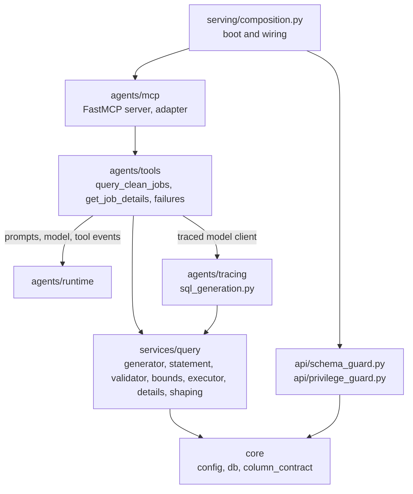
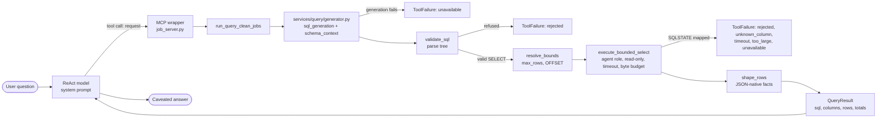

# Tools and query module guide

> **Last verified:** 2026-10-26

> **Eviction:** Rewritten when the tool surface, `src/services/query/`, the `clean_jobs` contract, or either boot guard changes shape, removed when the read-only query path is retired.

The tools-and-query module turns a natural-language question into one validated, bounded, read-only SQL statement against `clean_jobs`, and turns the rows back into typed facts the agent can describe.
It also owns what the model can see and touch: the 16-column contract, the least-privilege agent role, and the two boot guards that enforce both.
It does not own the prompt text ([the prompts guide](prompts.md)), the ReAct loop ([the runtime guide](runtime.md)), or the evaluation datasets (row 7 of #617).

## 1. Summary and scope

**Five words first.**

- **Request.** One standalone question in the user's language, restating every filter from earlier turns that still applies.
  The agent writes it; the tool does not read conversation history.
- **SQL generation.** One `sql_generation` model call that receives the SQL rules, the schema context, and the request, and returns one `SELECT`.
- **Validation.** A deterministic scope check read from PostgreSQL's parse tree: one statement, `SELECT` only, allowlisted table and functions, no comments, no hidden names.
- **Bounded read.** One transaction on the agent role, read-only at repeatable read, with a server-side statement timeout, a row cap, and a byte budget.
- **Facts.** The SQL, columns, rows, and real match total as typed JSON.
  The system prompt, not this module, owns the sentence the reader sees.

**What it owns.**

- The two public tools, `query_clean_jobs` and `get_job_details`, their MCP wrappers, and their typed results.
- SQL generation, validation, paging bounds, execution, and error mapping.
- The 16 visible and five hidden `clean_jobs` names in `src/core/column_contract.py`.
- The serving schema guard and the agent privilege guard.
- The read-only execution transaction and the two database URLs' split of responsibility.

**What it deliberately is not.**

- **Not the prompt.** The SQL rules and schema wording live in `config/prompts.yaml`; this module consumes them and never rewrites them.
- **Not the runtime.** The ReAct loop decides when to call a tool and how to phrase the answer; these tools return facts (#702).
- **Not the database boundary itself.** PostgreSQL enforces the column grant; the guards only refuse to boot when the boundary and the contract disagree.

## 2. Where it sits

Dependencies point inward: composition wires the MCP server, the MCP wrappers call the tools, and the tools call `services/query`, which imports only `src/core`.
`services/query` imports nothing from `src/agents`, `src/api`, or `src/serving`, and `src/services/query/generator.py` takes its model as a `SqlGenerationModel` protocol (#746).

The tool is the adapter that resolves those dependencies.
`query_clean_jobs.py` imports `runtime.prompts` for the release prompt text, `runtime.provider` to build the `sql_generation` model, `runtime.tool_events` to publish the card's row count, and `tracing.sql_generation` for `TracedSqlGenerationModel`.
That adapter, not the query service, owns the Langfuse branch, so generation runs in a test with a stub model and no runtime or tracing import.

Composition calls both guards at boot, before the agent is built, and discovers the tools once with `list_job_tools`.
Outside serving, `evals/run.py` builds the same MCP server, `evals/baseline_sql.py` calls `generate_sql` and `validate_sql` directly, and `evals/sql_gate.py` runs `validate_sql` on reviewed SQL with no model.

## 3. The path a question takes

1. **The agent chooses a tool.**
   The runtime sees two LangChain tools discovered from the in-process FastMCP server by `list_job_tools`; there is no loopback socket.
2. **The MCP wrapper keeps the public contract.**
   `query_clean_jobs` takes `request`; `get_job_details` takes a list of `id`s.
   A `ToolFailure` becomes a `ToolError`, which the adapter turns into a `status="error"` tool message.
3. **SQL generation is one service call.**
   `src/services/query/generator.py` joins `sql_generation`, `schema_context`, and the request into one message and calls the injected model client.
   The tool supplies `TracedSqlGenerationModel`, which builds the `sql_generation` profile from `config/settings.yaml`.
   Inside an agent, the ambient LangChain callbacks keep the generation in the trace; a plain MCP client gets an explicit Langfuse generation instead.
   A provider timeout, rate limit, or transport fault maps to `unavailable` with a fixed detail, and the cause stays server-side (#754).
4. **Validation is the trust boundary.**
   `validate_sql` returns the normalized statement or a reason that names the rule.
   Only a valid statement reaches the database.
5. **Bounds are resolved before execution.**
   `resolve_bounds` reads the statement's own `LIMIT`, `OFFSET`, or `FETCH FIRST` from the parse tree, honors a user limit only when it is at most `agent.query.max_rows` (20), and otherwise fetches the cap.
   An `OFFSET` is a position and is never capped.
6. **Execution is one bounded transaction.**
   Before running anything, the executor refuses an `OFFSET` page whose outermost `ORDER BY` does not include `id` (#727).
   The session then sets `REPEATABLE READ, READ ONLY`, sets the server-side `statement_timeout` (2000 ms), and runs `base_sql LIMIT n [OFFSET m]`.
   The companion `SELECT count(*) FROM (base_sql) AS q` runs only when the page starts past row 0 or fills its limit, and it sees the same snapshot.
7. **The result becomes facts.**
   Listing rows drop `description` (the detail tool fetches it), `Decimal` becomes `int` or `float`, dates become ISO strings, and `NULL` stays `null`.

`get_job_details` is the second path.
It de-duplicates ids, takes at most `agent.query.max_detail_ids` (3), runs the 16-column projection in the same bounded session, and returns `jobs`, `not_found`, and `not_fetched` in the request's order.

**Where the time goes.**
Measured on 2026-10-25 against a copy of the 2026-10-18 snapshot (367 postings) with DeepSeek live, over 25 direct tool calls:

| Step | Median | Range |
|---|---|---|
| SQL generation (one model call) | 773 ms | 582 to 1097 ms |
| Validation, bounds, execution, and shaping together | 6 ms | up to 54 ms |

Generation is about 99% of a tool call.
One parse costs about 0.12 ms, so running it at each of the three steps that need it is not worth caching.
A question the model answers in one call takes about 3.5 s end to end; one that needs several calls multiplies that (section 7).

## 4. What the model can see and touch

**The column contract.**

`clean_jobs` has 21 physical columns.
The agent may see 16:

`id`, `title`, `company`, `role`, `description`, `tech_stack`, `location`, `source_url`, `job_level`, `listing_expires_on`, `created_on`, `is_internship`, `salary_min`, `salary_max`, `salary_currency`, `is_salary_negotiable`.

The other five are hidden ingestion and lifecycle bookkeeping:

`source`, `external_id`, `posted_date`, `first_seen_at`, `last_seen_at`.

`src/core/column_contract.py` is the one application-side list.
The validator reads the hidden names for its explicit-name check, `fetch_job_details` reads the visible names for its projection, and both boot guards read the same contract.
The ORM and the prompt YAML keep their own declarations; `tests/test_prompt_consistency.py` keeps the three in agreement.

**Two database URLs, two jobs.**

- `DATABASE_URL` is the writer.
  Ingestion, the checkpointer, and the schema guard use it, and it owns the tables.
- `AGENT_DATABASE_URL` is the reader.
  Every generated query and every detail fetch uses `agent_session_factory` from `src/core/db.py`, so a query can only ever run as the column-granted role.

The split is what makes the grant meaningful.
The owner holds every privilege on its own tables, so if the query path reused the owner connection, a star query would return all 21 columns.

**The schema guard checks shape, not width.**

At boot, `assert_serving_schema` reads `information_schema.columns` for `public.clean_jobs` and checks two things:

- all 16 visible names exist;
- each has the expected `data_type` (`bigint`, `text`, `date`, `boolean`, or `numeric`).

Extra physical columns are logged as `api.schema_extra_columns` and ignored.
That tolerance is deliberate: migrations deploy separately from code, and a column that no one has granted to the agent cannot reach an answer.
A missing or retyped visible column still refuses boot with `SchemaGuardError`.

**The privilege guard checks the whole grant set.**

At boot, `assert_agent_privileges` runs one catalog query as the agent role and builds its effective privilege set: relation, sequence, and column privileges on every non-system relation, with inherited and `PUBLIC` grants resolved.
The only permitted rows are `SELECT` on the 16 visible columns of `public.clean_jobs`.
Anything else refuses boot: a table-level `SELECT`, a hidden-column grant, a write, a grant on `raw_jobs` or the checkpoint tables, or a sequence grant.
The guard inspects whatever database the agent URL names and fails closed when it cannot connect; there is no "nothing to check" skip.

**Why adding a column is not free.**

Adding a physical column without granting it is safe: the schema guard tolerates it, the privilege guard sees no new grant, and PostgreSQL refuses it to the agent.
Making it visible is a contract change.
The grant and the release that declares the column must land as one coordinated cutover, because the privilege guard requires exactly the declared set in both directions.
The full procedure is in [the schema reference](../reference/schema.md#adding-a-physical-column).

## 5. The validator: what it catches, and what it cannot

`validate_sql` parses the statement with PostgreSQL's own grammar through `pglast`, and `src/services/query/statement.py` reads every fact from the tree (ADR-0065).
The checks run in this order, and the first failure is the reason the model reads:

1. it is not empty, it is one statement, and it starts with `SELECT`, `WITH`, or a parenthesised `SELECT`;
2. it contains no SQL comments;
3. PostgreSQL parses it and the top-level node is a `SELECT`, including CTEs, subqueries, set operations, and set-returning functions in `FROM`;
4. it does not write: no `SELECT INTO`, no row locking, and no data-modifying statement in a `WITH` clause;
5. every relation is `clean_jobs`, `public.clean_jobs`, or a CTE in scope, no system table is named, and there is no self-join;
6. every function is on the explicit allowlist, while server identity functions and server-side calls are refused by name;
7. no hidden column is named; and
8. its bounds are integer literals, with `FETCH ... WITH TIES` refused.

Because the checks read the tree, a `--` inside a string literal stays data, a CTE is not mistaken for a relation, and `LIMIT 2 + 1` is refused as a non-literal bound instead of becoming a second `LIMIT`.
A split breakdown such as `FROM clean_jobs, string_to_table(location, ',') AS city` passes, so "count a posting once per city it lists" can run.

**What it does not decide.**

- **Columns read through a star or a whole row.**
  A star, an aliased star, a whole-row reference, or a CTE that selects `*` is outside what this filter models as a column read.
  That is why the column grant exists: PostgreSQL refuses every one of those forms for the agent role, and the tool maps the refusal to a `rejected` failure that tells the model to select the declared columns explicitly (ADR-0063).
- **Types and grouping.**
  The parser checks grammar, not meaning, so a type mismatch or an `ORDER BY` column missing from `GROUP BY` reaches PostgreSQL and fails there as a rejection the model can rewrite (section 6).
- **Whether the SQL answers the question.**
  A valid statement can still group the wrong thing; that is the prompt's job and the baseline's to measure.

## 6. Bounds, deadlines, and failures

All values are in `config/settings.yaml` under `agent.query`.

| Bound | Default | What it protects |
|---|---|---|
| `max_rows` | 20 | Rows one listing may return; a larger user `LIMIT` is capped |
| `max_detail_ids` | 3 | Postings one detail call may fetch; the rest come back as `not_fetched` |
| `statement_timeout_ms` | 2000 | Server-side cancellation of one expensive statement |
| `max_result_bytes` | 262144 | Bytes the rows may occupy before they enter the agent |

Three independent mechanisms keep the read safe:

- **The role.** The agent role holds no write privilege and no table-level `SELECT`.
- **The transaction.** Every read starts `SET TRANSACTION ISOLATION LEVEL REPEATABLE READ, READ ONLY`.
- **The validator.** It refuses statements that are not a single `SELECT` on `clean_jobs` using allowlisted functions.

**The turn deadline does not stop a statement.**
The runtime's 120 s turn deadline cancels the turn, but the query runs in a worker thread through `asyncio.to_thread`, and that thread finishes its statement.
The statement timeout is what bounds it: at most 2000 ms for the fetch and 2000 ms for the companion count.

**Failures.**
Each failure the module maps reaches the model as one kind and a short, English detail.
A driver message that could name the database host never travels to the model.

| Cause | Kind | Detail the model reads | What the model can do |
|---|---|---|---|
| The validator refuses the statement, including a non-literal bound | `rejected` | The rule, for example "Server identity functions are not allowed: version" | Rewrite the statement |
| An `OFFSET` page without `id` in the outermost `ORDER BY` | `rejected` | How to add the tiebreak | Rewrite with `ORDER BY ..., id` |
| The column grant refuses a star or whole-row read (42501) | `rejected` | Select the 16 declared columns explicitly | Rewrite with named columns |
| A deterministic refusal from SQLSTATE class 42: syntax (42601), grouping (42803), datatype mismatch (42804), undefined function (42883) | `rejected` | PostgreSQL's primary message | Rewrite the statement |
| An unknown column (42703) | `unknown_column` | PostgreSQL's message naming the column | Say the data has no such field |
| The statement timeout fires (57014) | `timeout` | "statement exceeded the 2000 ms limit" | Narrow the query |
| The rows exceed the byte budget | `too_large` | Select fewer columns | Narrow the projection |
| The SQL-generation call times out or the provider fails | `unavailable` | "the SQL generator did not answer" | Report that the search failed |
| Any other database error | `unavailable` | "the database could not run the query" | Report that the search failed |

A permission denial on an object other than the `clean_jobs` column grant is an operational grant fault rather than a mistake in the generated statement, so it stays `unavailable` even though SQLSTATE 42501 is in class 42.

`unavailable` is logged at ERROR; every other kind is a refusal the model can recover from and is logged at WARNING.
The generation cause is logged with its traceback, so the model's bounded detail does not cost diagnosability.
As a backstop, the MCP server sets `mask_error_details`, so an exception no path maps reaches the model as FastMCP's generic message rather than its raw text.

## 7. Behaviours that surprise a new developer

1. **A larger `LIMIT` is capped silently.**
   "Show me 50" fetches 20, and the `sql` the model reads ends `LIMIT 20`, because `sql` is the statement that ran after bounds.
2. **`description` never appears in a listing, even when asked for.**
   `shape_rows` drops it; only `get_job_details` returns it.
3. **The real total is counted only when it can differ from the page.**
   A page that does not fill its limit and starts at row 0 reports its own row count as the total, with no second statement.
4. **The tool card's count is not always `total_rows`.**
   A listing publishes the match total, a count query publishes the counted figure, and any other aggregate publishes no count at all (#677).
5. **A multi-value column is one string.**
   `location` and `tech_stack` hold comma-separated values, so `GROUP BY location` counts "Hanoi, Ho Chi Minh City" as its own city.
   The validator accepts the split form, but the prompt does not ask for it yet: on the snapshot the served chat route answers Hanoi 196 instead of 233, and a top-skills question took 5 tool calls and 17 s (#750).
6. **The paging rule leaks into aggregates.**
   The prompt's rule to end every list of postings with `id` is sometimes applied to a `GROUP BY` statement, which PostgreSQL refuses with a grouping error that reaches the model as `rejected`, carrying the server's message, so the next rewrite can drop the stray column (#750, #751).
7. **Only one query setting is checked at boot.**
   The `get_job_details` description embeds `agent.query.max_detail_ids` when composition builds the MCP server, so a bad value fails boot, while a bad `max_rows`, `statement_timeout_ms`, or `max_result_bytes` fails only the first query (#616).
8. **A user can dictate SQL to the tool.**
   "Run exactly this statement" often reaches the SQL model verbatim: two of three such requests did in the measurement above.
   That is why the validator, the role, and the read-only transaction each refuse independently, rather than trusting the model to decline.

## 8. Trade-offs, and what would now be decided differently

**Deliberate, and still right.**

- **Model-written SQL, not a structured query API.**
  A structured API would be easier to bound but would cap the questions the agent can answer.
  The price is a validator, a prompt contract, and a database grant that must all agree; they are tested separately because any one alone is a single point of failure.
- **Facts, not sentences.**
  The tools return `sql`, `columns`, `rows`, and totals; the system prompt owns every user-facing word (#702).
  This keeps wording changes out of the data path and makes the same facts reusable by the card, the model, and the evals.
- **The database owns the column boundary.**
  The parser proves the statement's shape and scope, but a star and a whole-row reference still pass it as a read.
  The grant refuses them (#722, ADR-0063), and the tests pin both layers.
- **An allowlist of functions.**
  A function is unavailable until a reviewed change adds it with its test, which is the right default for a trust boundary even though it means the occasional legitimate function is refused (ADR-0065).
- **MCP in process, with the endpoint kept.**
  The tools are a FastMCP server discovered in process, which costs about 7 ms per call and gives the tools a typed public contract (#465).
  The Streamable HTTP endpoint at `/mcp` stays, disabled unless `MCP_ENABLED` is set, for local manual testing; the public deployment never sets it.
- **The whole page is measured in memory.**
  The byte budget is a simple, deterministic guard that runs before the companion count.
  Streaming would complicate the tool contract for a result that is already capped at 20 rows.

**Decided differently, and already changed.**

- **One column contract and an additive-tolerant schema guard (#743).**
  The contract used to be copied into the guards, the validator, the fixture loader, and the detail projection, and the schema guard demanded an exact column match.
  That made an additive migration an outage and let the copies drift.
- **The parser instead of regular expressions (#749, ADR-0065).**
  The text scans refused CTEs and split breakdowns, corrupted `FETCH FIRST` and `LIMIT ALL`, and used a denylist of function names.
- **SQL generation in `services/query` behind an injected model (#753).**
  Generation used to live in the tool and import the runtime and Langfuse directly, so the query service could not run without both.

**Decided differently, not yet changed.**

- **`agent.query` should be typed and validated at boot** with the rest of `agent.*`, replacing three hand-written loaders (#616).

## 9. Changing it safely

- **Add or remove a visible column.**
  Follow [Adding a physical column](../reference/schema.md#adding-a-physical-column).
  Update the contract, the prompt surfaces, the ORM, the fixture seed, and the grant migration together.
  A hidden addition needs only the ORM and a migration; adding its name to `HIDDEN_COLUMNS` also gives it the validator's explicit-name refusal.
- **Change a validator rule or the function allowlist.**
  Add the case to `tests/services/query/test_sql_validator.py`, and to `evals/datasets/sql_guard.yaml` when the gate should pin it.
  Remember that the grant, not the validator, is the column boundary.
- **Change a bound.**
  Edit `agent.query` and update `tests/services/query/test_executor_bounds.py`.
  Only `max_detail_ids` is checked at boot today, so start the app and run one query before deploying a change to the other three (#616).
- **Change a tool name, argument, or result shape.**
  That is a compatibility decision (#465).
  The MCP wrapper, the prompt, the web card, and the evals all name the surface.
- **Change the role or its grants.**
  Follow [the operate how-to](../how-to/operate.md#create-the-agent-read-least-privilege-role); the next boot refuses anything outside the contract.

## 10. Code map

| Start here | For |
|---|---|
| `src/agents/mcp/job_server.py` → `create_job_mcp_server`, `to_tool_error`, `mcp_endpoint_enabled` | The two public MCP tools, descriptions, error log levels, and the optional `/mcp` endpoint |
| `src/agents/mcp/adapter.py` → `list_job_tools` | In-process tool discovery |
| `src/agents/tools/query_clean_jobs.py` → `generate_sql`, `run_query_clean_jobs` | Dependency resolution, validation, bounds, execution, failure mapping, typed facts |
| `src/agents/tracing/sql_generation.py` → `TracedSqlGenerationModel` | The injected model client and its trace attachment |
| `src/services/query/generator.py` → `generate_sql`, `build_prompt`, `SqlGenerationModel` | Prompt assembly and the model seam, with no runtime or tracing |
| `src/agents/tools/get_job_details.py` → `run_get_job_details` | The detail tool's id cap and typed result |
| `src/agents/tools/failures.py` → `ToolFailure`, `FailureKind` | The failure vocabulary |
| `src/services/query/sql_validator.py` → `validate_sql`, `has_id_tiebreak` | The public scope-check and total-order entry points |
| `src/services/query/statement.py` → `parse_statement`, `StatementError` | The parse; relations, functions, hidden names, bounds, and order facts from the tree |
| `src/services/query/row_bound.py` → `resolve_bounds` | User limit, cap, and page offset read from the tree |
| `src/services/query/executor.py` → `execute_bounded_select`, `bounded_session`, `_map_db_error` | Read-only transaction, timeout, row cap, byte budget, SQLSTATE mapping |
| `src/services/query/job_details.py` → `fetch_job_details`, `FULL_DETAIL_COLUMNS` | The 16-column detail projection |
| `src/services/query/table_formatter.py` → `shape_rows`, `json_value` | JSON-native facts and the listing's description drop |
| `src/core/column_contract.py` → `VISIBLE_COLUMNS`, `HIDDEN_COLUMNS` | The one application-side column contract |
| `src/api/schema_guard.py` → `assert_serving_schema` | Boot check of the visible names and types; additive columns ignored |
| `src/api/privilege_guard.py` → `assert_agent_privileges` | Boot check of the complete agent privilege set |
| `tests/services/query/`, `tests/api/test_schema_guard.py`, `tests/api/test_privilege_guard.py` | The behaviour pinned by tests |
